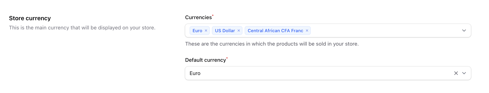

Currencies define the monetary units used across your store. Each [zone](/2.x/zones) is associated with a currency, and each [price](/2.x/pricing) record is linked to a currency. Shopper supports multi-currency pricing out of the box, with over 150 currencies seeded during installation.

## Model

The model used is `Shopper\Core\Models\Currency`. It implements `Shopper\Core\Models\Contracts\Currency`. The model has a global `enabled` scope that automatically filters out disabled currencies (see [Pricing](/2.x/pricing#currency-model) for details).

### Database Schema

Currencies are stored in the `currencies` table with the [table prefix](/2.x/configuration#database-table-prefix) set in `config('shopper.core.table_prefix')`, so `sh_currencies` by default. The table has no timestamps.

| Column | Type | Nullable | Default | Description |
|--------|------|----------|---------|-------------|
| `id` | bigint | no | auto | Primary key |
| `name` | string | no | - | Currency name (e.g., "US Dollar") |
| `code` | string(10) | no | - | ISO 4217 code (e.g., "USD"), unique |
| `symbol` | string(25) | no | - | Currency symbol (e.g., "$") |
| `format` | string(50) | no | - | Display format pattern (e.g., "$1,0.00"). `shopper_money_format()` does not read it |
| `exchange_rate` | decimal(10,2) | yes | null | Exchange rate relative to the store's default currency. Stored for reference only: Shopper never converts prices with it |
| `is_enabled` | boolean | no | true | Whether the currency is enabled |


## How Currencies are Created

Currencies are defined in the `database/data/currencies.json` file of the `shopper/core` package. When you run `php artisan shopper:install` and answer yes to "Run database migrations and seeders?", the `Shopper\Core\Database\Seeders\CurrenciesTableSeeder` seeder reads this file and inserts its 158 currencies, all enabled. If you skipped that step, run the Shopper seeder yourself. It also seeds the countries, legal pages, default channel, carrier and payment method:

```bash
php artisan db:seed --class="Shopper\Core\Database\Seeders\ShopperSeeder"
```

Shopper ships with over 150 currencies out of the box, so you rarely need to add more. If you do need a custom currency, such as the Sierra Leonean leone (`SLE`) that the file does not have, create a migration that inserts it through the `Currency` model, which writes to the prefixed table:

```php
<?php

use Illuminate\Database\Migrations\Migration;
use Shopper\Core\Models\Currency;

return new class extends Migration
{
    public function up(): void
    {
        Currency::query()->create([
            'name' => 'Sierra Leonean Leone',
            'code' => 'SLE',
            'symbol' => 'Le',
            'format' => 'Le1,0.00',
        ]);
    }
};
```

## How to Set Up Store Currencies [#how-setup-store-currencies]

After installing Shopper, you need to [set up your store](/2.x/setup-store). During this step you choose the currencies you want for your store and the one used by default, which must be one of them. Once you've done this, you can change these currencies in the Store currency section of your general settings, `Settings > General`. Both steps only list enabled currencies.

<Frame caption="Store currency">
  
</Frame>

The `Settings > Currencies` page lists every currency in the table, disabled ones included. There you enable or disable currencies, one at a time with the status toggle or several at once with the bulk actions, and edit their exchange rate. Names, codes and symbols cannot be edited from this page. It requires the `access_setting` permission.

<Warning>
Only disable currencies your store does not use. The `enabled` scope hides a disabled currency, so `$zone->currency` and `$price->currency` return `null`, the `currency_code` attribute of a zone or a price throws an error, and if it is the default currency, `shopper_currency()` returns `USD` once its one-hour cache expires. Do not delete a currency either: deleting it also deletes every zone and every price that uses it.
</Warning>

## Zero-Decimal Currencies

Some currencies have no subdivision (no "cents"). For example, the Japanese Yen (JPY) and the Central African CFA Franc (XAF) are stored as whole numbers, so 1000 JPY is stored as `1000`, not `100000`.

Shopper handles this automatically. The `is_no_division_currency()` helper checks if a currency code (in uppercase) is zero-decimal, and `zero_decimal_currencies()` returns the full list:

```php
is_no_division_currency('XAF'); // true
is_no_division_currency('USD'); // false

zero_decimal_currencies();
// ['BIF', 'CLP', 'DJF', 'GNF', 'HTG', 'JPY', 'KMF', 'KRW',
//  'MGA', 'PYG', 'RWF', 'VND', 'VUV', 'XAF', 'XAG', 'XAU',
//  'XDR', 'XOF', 'XPF']
```

The `shopper_money_format()` helper and the `MoneyInput` form component both use this to determine whether to divide/multiply by 100. See the [Pricing documentation](/2.x/pricing) for details.

## Relation to Other Entities

[Carts](/2.x/cart) and [orders](/2.x/orders) do not reference a currency row: they store the ISO code in a `currency_code` column. A new cart uses `shopper_currency()` unless you pass a `currency_code`.

### Store

A store has a default currency and can have many currencies. These currencies are then used in other relations: the admin only offers the store currencies when you associate a zone with a currency or set the prices of a product or a variant.
These 2 values are stored through the `Shopper\Core\Models\Setting` model, in the rows whose `key` column is `default_currency_id` and `currencies`.

The `shopper_setting('default_currency_id')` helper returns the ID of the default currency, and `shopper_setting('currencies')` returns an array with the IDs of the currencies set up for your store. The `shopper_currency()` helper returns the code of the default currency, or `USD` when none is set (see [Default Currency](/2.x/pricing#default-currency)):

```php
use Shopper\Core\Models\Currency;

$storeCurrencies = Currency::query()
    ->whereIn('id', shopper_setting('currencies') ?? [])
    ->get();

$defaultCurrencyCode = shopper_currency(); // "EUR"
```

### Zone

Each Zone is associated with a currency. A currency can be used in more than one zone, but a zone can have only one currency.

The relation is available on a Zone through the `currency` relation and will return a `Shopper\Core\Models\Currency` object.
You can also access the currency code through the attribute `currency_code` on the zone. From the currency side, `$currency->zone` returns only one of its zones: see [Zone Relationship](/2.x/pricing#zone-relationship) to get all of them.

### Price

The Price entity is used to represent a price associated with an entity, for example for products or variants. Each price is associated with a currency.

The relation is available on a Price through the `currency` relation and will return a `Shopper\Core\Models\Currency` object.
You can also access the currency code through the attribute `currency_code` on the price.
