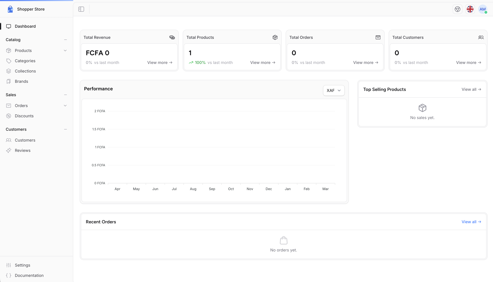
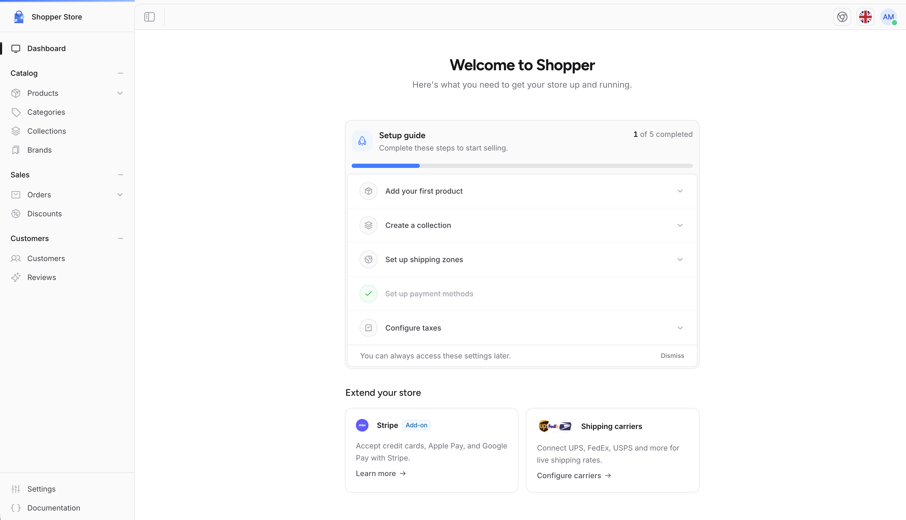

The dashboard is the first screen after login. It shows store health at a glance: revenue trends, key metrics, recent orders, top products, and an onboarding guide that auto-dismisses once the store is configured.

<Frame>
  
</Frame>

{/* SCREENSHOT NEEDED: The full dashboard page after the setup guide is dismissed. Show all 4 stat cards at the top (Revenue, Products, Orders, Customers with trend indicators), the revenue bar chart on the left, the top selling products table on the right, and the recent orders table below. Use the demo store data so the charts have realistic numbers. */}

## Components

The dashboard is composed of five Livewire components, each with independent caching and a focused responsibility.

### RevenueChart

Displays monthly revenue as a bar chart for the last 12 months. Data is grouped by month in a single aggregated query and cached with flexible TTL (fresh for 5 minutes, stale up to 30 minutes).

The chart supports a currency filter. When you have multiple active currencies, a dropdown lets you switch between them. The Y-axis and tooltip are formatted using `Intl.NumberFormat` with the application locale, followed by the currency symbol.

The revenue query supports MySQL, PostgreSQL, and SQLite with database-specific date expressions.

### StatCards

Shows four summary cards comparing the current month to the previous month:

| Card | Metric | Scope |
|------|--------|-------|
| Revenue | Sum of `price_amount` on paid orders | Current currency |
| Products | Total product count, monthly new products for trend | All types |
| Orders | Count of paid orders, monthly count for trend | All currencies |
| Customers | Count of users with the `user` role (the `customers` scope), monthly new customers for trend | All |

Each card shows the percentage change versus the previous month, with a green or red trend indicator. Cards link to their respective admin sections.

### RecentOrders

A table of the 7 most recent orders, excluding orders with Cancelled or Archived status. Each row shows the order number, first product with thumbnail, total amount, order status badge, and links to the order detail page.

### TopSellingProducts

Ranks the top 6 products by total quantity sold across paid orders. Variant sales are aggregated back to the parent product. Each row shows the product thumbnail, name, total units sold, and average review score.

### SetupGuide

An interactive checklist that guides new stores through the essential configuration steps. It appears on first login and auto-detects completion by querying the database:

<Frame>
  
</Frame>

{/* SCREENSHOT NEEDED: The setup guide as it appears on a fresh install. Show the welcome message at the top, the progress bar showing "1 of 5 completed" (the seeders create the cash on delivery payment method), and the 5 expandable steps listed below. Expand one step (e.g. "Add a product") to show the description and action button. The "Extend your store" section with Stripe and Shipping cards should be visible at the bottom. */}

| Step | Completed when | Permission |
|------|---------------|------------|
| Add a product | At least one product exists | `add_products` |
| Create a collection | At least one collection exists | `add_collections` |
| Set up shipping zones | At least one enabled shipping zone exists | `access_setting` |
| Set up payment methods | At least one enabled payment method exists | `access_setting` |
| Configure taxes | At least one tax zone exists | `access_setting` |

When all steps are complete, the guide saves a `setup_guide_done` setting and dispatches a `setup-guide-completed` event to hide itself. This check runs when the dashboard loads, for a user with the `access_setting` permission. The guide does not reappear on subsequent visits. A user with `access_setting` can also dismiss it early with the dismiss button.

## Caching

Each dashboard component caches its data independently. The cache keys and TTLs are:

| Component | Cache key | Fresh TTL | Stale TTL |
|-----------|-----------|-----------|-----------|
| RevenueChart | `dashboard:revenue:{currency}` | 5 min | 30 min |
| StatCards | `dashboard:stat-cards:{locale}` | 5 min | 30 min |
| RecentOrders | `dashboard.orders:recent-ids` | 1 min | 5 min |
| TopSellingProducts | `dashboard.products:top-selling` | 5 min | 30 min |

To clear the dashboard cache manually (for example after a data import), flush the keys:

```php
use Illuminate\Support\Facades\Cache;

Cache::forget('dashboard:revenue:USD');
Cache::forget('dashboard:stat-cards:en');
Cache::forget('dashboard.orders:recent-ids');
Cache::forget('dashboard.products:top-selling');
```

## Access Requirements

The dashboard middleware checks two conditions before rendering the page. The user must be an administrator, a manager, or have the `access_dashboard` permission. The store must have the `email` and `street_address` settings configured (these are set during the initial store setup).

The middleware runs on every page of the admin panel, not only the dashboard. If the settings are missing, it redirects to the store initialization page. If the user lacks permission, Shopper redirects to its forbidden page.

## Customizing the Dashboard

### Replacing the Entire Page

The dashboard page is registered in the components configuration. Publish the dashboard component config to swap it with your own implementation:

```bash
php artisan shopper:component:publish dashboard
```

This creates `config/shopper/components/dashboard.php`:

```php
use Shopper\Livewire\Components;
use Shopper\Livewire\Pages;

return [
    'pages' => [
        'dashboard' => Pages\Dashboard::class,
    ],
    'components' => [
        'locale-switcher' => Components\LocaleSwitcher::class,
    ],
];
```

Replace the page class with your own component:

```php
'pages' => [
    'dashboard' => App\Livewire\Pages\Dashboard::class,
],
```

Your component only needs to render a view with the app layout. The simplest override:

```php
namespace App\Livewire\Pages;

use Illuminate\Contracts\View\View;
use Livewire\Component;

final class Dashboard extends Component
{
    public function render(): View
    {
        return view('dashboard.index')
            ->layout('shopper::components.layouts.app', [
                'title' => 'Dashboard',
            ]);
    }
}
```

### Overriding Individual Components

If you want to replace a single widget (for example, swap the revenue chart for a custom report), override the dashboard Blade view.

Shopper has no publish tag for its views. Copy `vendor/shopper/framework/resources/views/livewire/pages/dashboard.blade.php` to `resources/views/vendor/shopper/livewire/pages/dashboard.blade.php`: Laravel loads your copy instead of the package view. The view shows the setup guide until it is completed, then renders each widget with a Livewire tag that you can replace:

```blade
@if ($this->showSetupGuide)
    <livewire:shopper-setup-guide />
@else
    <livewire:shopper-dashboard.stat-cards />
    @can('browse_orders')
        <livewire:shopper-dashboard.revenue-chart />
        <livewire:shopper-dashboard.top-selling-products />
        <livewire:shopper-dashboard.recent-orders />
    @endcan
@endif
```

Replace any tag with your own Livewire component or plain Blade content. The copy no longer follows updates of the package view, so compare it with the original after each Shopper upgrade.

## Adding Content via Render Hooks

If you only want to inject content above or below the dashboard without replacing the page or publishing views, use the layout render hooks:

```php
use Shopper\Facades\Shopper;
use Shopper\View\LayoutRenderHook;

Shopper::renderHook(
    LayoutRenderHook::DASHBOARD_START,
    fn (): string => view('dashboard.store-alert-banner')->render(),
);

Shopper::renderHook(
    LayoutRenderHook::DASHBOARD_END,
    fn (): string => view('dashboard.custom-reports')->render(),
);
```

Register these hooks in a service provider's `boot` method. See the [Render Hooks](/2.x/render-hooks) documentation for the full list of available injection points.
