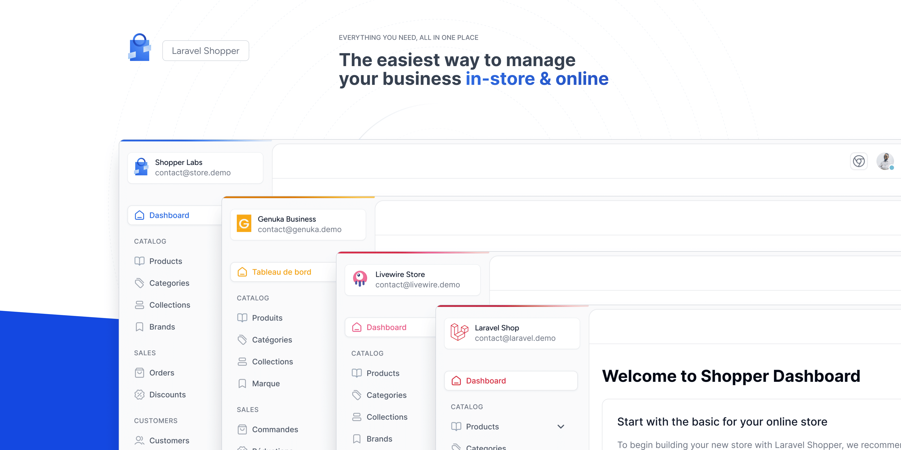

Shopper is an open-source headless e-commerce package for Laravel. It provides a production-ready admin panel, a flexible product catalog, and all the commerce logic your store needs, built on the tools you already know, without taking over your codebase.

<Frame>
  
</Frame>

## Why Shopper?

There are several ways to add e-commerce to a Laravel application. You could integrate an external platform like Shopify, adopt a full e-commerce system like Lunar or Bagisto, or build everything from scratch. Each approach has trade-offs.

Shopper takes a different path. It is a Laravel package, not a platform. You install it into your existing application the same way you would install `spatie/laravel-permission` or `laravel/cashier`. Your routes, your middleware, your authentication, your deploy pipeline stay unchanged. You add e-commerce to your app, not the other way around.

### Building Blocks, Not a Monolith

Most e-commerce systems assume one-size-fits-all. But selling cars is not the same as selling sneakers, and a subscription box service has nothing in common with a marketplace. Shopper recognizes this by giving you composable building blocks instead of a rigid platform.

The main Eloquent models (products, categories, orders and more) can be swapped for your own classes through configuration. The admin pages can be replaced with your own Livewire components. Optional sections such as brands, discounts or reviews can be turned off. You start with a production-ready foundation and shape it to match your business.

### Headless from Day One

Shopper handles the commerce logic and the admin panel. You build the storefront with whatever stack your team already ships with. Blade, Livewire, Inertia, Next.js, Nuxt, React Native, or anything else. Shopper has no opinion on how you present your store to customers.

### A Package, Not a Platform

This distinction matters. A platform owns your application. You build on top of it, adapt to its conventions, and work within its constraints. A package is a tool you control. Shopper adds e-commerce capabilities to your Laravel application without replacing your User model, your authentication system, or your application structure.

Your User model gains Shopper capabilities through a trait. The admin panel is a feature of your app, not the other way around. Your database is extended, not replaced.

## Tech Stack

Shopper is built on top of [Laravel](https://laravel.com), [Filament](https://filamentphp.com), and [Tailwind CSS](https://tailwindcss.com). The admin panel is made of [Livewire](https://livewire.laravel.com) pages that use Filament's tables, forms and actions. It is not a Filament panel plugin: it registers its own routes and layout.

<Note>
  Although the admin panel uses Laravel Livewire, there is no requirement for the storefront to use Livewire. You can build your storefront with any stack.
</Note>

## Packages

Shopper is made up of several Composer packages that work together. Installing `shopper/framework` pulls in `core`, `cart`, `payment`, `shipping` and `sidebar`:

- `shopper/core` is the e-commerce engine: models, contracts, migrations, enums and observers. It has no dependency on any UI layer.

- `shopper/framework` is the admin panel, for managing products, orders, customers, and more. It provides all Livewire pages and components, and adds media library support (through [Spatie Media Library](https://spatie.be/docs/laravel-medialibrary)) to products, variants, categories, brands and collections.

- `shopper/cart` handles shopping carts and calculates their totals through a pipeline (lines, discounts, taxes).

- `shopper/payment` provides a driver-based payment architecture. The official [Stripe](https://stripe.com) driver is a separate package, `shopper/stripe`, that you install with Composer.

- `shopper/shipping` calculates shipping rates through drivers, with FedEx, UPS and USPS drivers included. Carriers and zones themselves are core models.

- `shopper/sidebar` builds the admin panel navigation. You use it when you add your own entries to the [sidebar](/2.x/sidebar/overview).

- `shopper/upgrade` is a temporary package for upgrades: an Artisan command for data fixes and [Laravel Boost](https://github.com/laravel/boost) skills that guide an AI assistant through breaking changes. You install it as a dev dependency when an [upgrade guide](/2.x/upgrade) asks for it, and remove it after.

For storefront development, the npm package `@shopperlabs/shopper-types` provides TypeScript type definitions for Shopper's models.

The `core` package defines contracts (interfaces) for its models. When you swap a model via configuration, the entire system (admin panel, relationships, route bindings) uses your custom class automatically.

## Key Features

Shopper ships with everything you need to run an online store:

<CardGroup cols={3}>
  <Card title="Products" icon="box">
    Variants, attributes, media, and multiple product types (standard, virtual, external, variant).
  </Card>
  <Card title="Orders" icon="cart-shopping">
    Full order lifecycle with independent payment, shipping, and order statuses.
  </Card>
  <Card title="Categories" icon="folder-tree">
    Unlimited hierarchical nesting with SEO fields and media.
  </Card>
  <Card title="Collections" icon="layer-group">
    Manual or rule-based product grouping.
  </Card>
  <Card title="Customers" icon="users">
    Customer profiles, addresses, and order history.
  </Card>
  <Card title="Discounts" icon="tags">
    Discount codes with rules, conditions, and usage limits.
  </Card>
  <Card title="Inventory" icon="warehouse">
    Multi-warehouse stock tracking with allocation and audit trails.
  </Card>
  <Card title="Shipping" icon="truck">
    Carriers, zones, rates, and shipment tracking.
  </Card>
  <Card title="Payments" icon="credit-card">
    Driver-based payment processing, with an official Stripe driver.
  </Card>
  <Card title="Brands" icon="store">
    Organize products by brand with media and SEO.
  </Card>
  <Card title="Reviews" icon="star">
    Customer product reviews and ratings.
  </Card>
  <Card title="Channels" icon="globe">
    Assign products to the sales channels they are sold on, such as a web store or a mobile app.
  </Card>
</CardGroup>

## Extensibility

Shopper is designed to be extended, not forked. Three mechanisms make this possible.

**Model swapping** lets you replace a model with your own class that extends it. The twelve swappable models (products, variants, categories, brands, collections, orders, channels, inventories, suppliers, addresses, tax zones and tax rates) are listed in `config/shopper/models.php`. Point an entry to your class and the entire system uses it, including the admin panel, relationships, and route model binding.

**Component overriding** lets you replace an admin panel page or form with your own Livewire component. Run `php artisan shopper:component:publish product` to get `config/shopper/components/product.php`, where each page and form of that section points to a class you can change. Pass `--all` to publish every section at once.

**Feature toggling** lets you remove optional sections of the admin panel: attributes, brands, categories, collections, discounts, reviews, suppliers and tags. Set a feature to `FeatureState::Disabled` in `config/shopper/features.php` and its pages and menu entries disappear.

## Stability and Versioning

Shopper follows [Semantic Versioning](https://semver.org/). Minor and patch releases never contain breaking changes. Every component is tested, and upgrade guides are published for every major version bump.

For details on supported versions and maintenance windows, see the [Version Support Policy](/2.x/version-support-policy).

## When Shopper Fits

Shopper is the right choice when you already have a Laravel application (or want to build one) and need to add e-commerce capabilities without adopting an opinionated platform. It works well when your storefront is non-standard: a product configurator, a subscription service, an auction site, or anything that does not fit the typical "browse and checkout" template.

If you need a store running in an hour, Shopify is a better fit. If you are not in the Laravel ecosystem, MedusaJS is worth considering.

## Next Steps

<CardGroup cols={3}>
  <Card title="Requirements" icon="server" href="/2.x/requirements">
    Check server requirements before installing.
  </Card>
  <Card title="Installation" icon="download" href="/2.x/installation">
    Install Shopper in your Laravel application.
  </Card>
  <Card title="Demo Store" icon="shop" href="/2.x/demo-store">
    Explore a working Shopper store.
  </Card>
</CardGroup>
