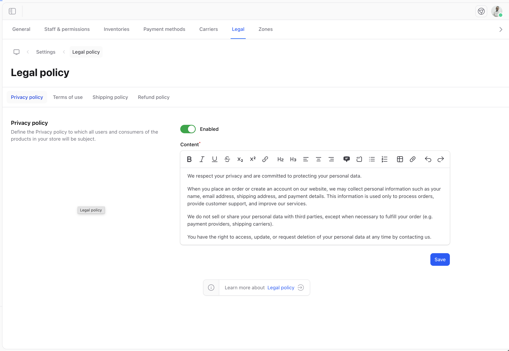

As with any e-commerce site, it is important for users to know the terms and conditions and privacy policy that your site offers. This is for their own safety and yours as well.

This section allows you to set up your pages for your privacy policy, refund policy, terms of use and shipping policy to be presented to customers.

## Model

The model used is `Shopper\Core\Models\Legal`. It uses the `HasSlug` trait: a slug you assign is converted with `Str::slug()` and gets a `-1`, `-2` suffix when another page already uses it. The trait does not build the slug from the title. It also adds `Legal::findBySlug('privacy')`, which returns the page whether it is enabled or not and throws a `ModelNotFoundException` when no page has that slug.

### Database Schema

Legal pages are stored in the `sh_legals` table (`sh_` is the default [table prefix](/2.x/configuration#database-table-prefix)).

| Column | Type | Nullable | Default | Description |
|--------|------|----------|---------|-------------|
| `id` | bigint | no | auto | Primary key |
| `title` | string | no | - | Legal page title |
| `slug` | string | yes | null | URL-friendly identifier (unique) |
| `content` | longtext | yes | null | Legal page content, HTML from the rich text editor |
| `is_enabled` | boolean | no | false | Whether this legal page is published |
| `created_at` | timestamp | yes | null | Creation timestamp |
| `updated_at` | timestamp | yes | null | Last update timestamp |

## Components

The components used to manage Legal pages are found in the component configuration file `config/shopper/components/setting.php`. To publish it in your application:

```bash
php artisan shopper:component:publish setting
```

```php
use Shopper\Livewire;

return [
    'pages' => [
        // ...
        'legal' => Livewire\Pages\Settings\LegalPage::class,
        // ...
    ],
    'components' => [
        // ...
        'settings.legal.privacy' => Livewire\Components\Settings\Legal\Privacy::class,
        'settings.legal.refund' => Livewire\Components\Settings\Legal\Refund::class,
        'settings.legal.shipping' => Livewire\Components\Settings\Legal\Shipping::class,
        'settings.legal.terms' => Livewire\Components\Settings\Legal\Terms::class,
        'settings.legal.form' => Livewire\Components\Settings\Legal\PolicyForm::class,
        // ...
    ],
];
```

`LegalPage` renders the tabs. Each tab component (`Privacy`, `Refund`, `Shipping`, `Terms`) shows the heading of its policy, and `PolicyForm` is the form the four tabs share.

## Add Legal content

In your admin panel, click **Settings** at the bottom of the sidebar, then **Legal**. The page is at `/{prefix}/setting/legal`, where the prefix is `config('shopper.admin.prefix')` (`cpanel` by default), and it requires the [`access_setting`](/2.x/acl#system-permissions) permission.

The installer seeds four legal pages through `Shopper\Core\Database\Seeders\LegalsPageTableSeeder`, with the slugs `privacy`, `terms`, `shipping` and `refund`. Each one is a tab of this page: Privacy policy, Terms of use, Shipping policy and Refund policy. The admin panel edits these four pages and has no button to add or rename one.

Write the content of each page, turn on the **Enabled** toggle and click **Save**. Only enabled pages are returned by `Legal::enabled()` in your front-end. The seeded pages start enabled and without content, and the form requires content to save, even to disable a page: write the content of a page before you link to it from your store.

<Frame>
  
</Frame>

<Warning>
Shopper does not generate the routes for the legal pages, you should set them up yourself. As mentioned in the [introduction](/2.x/getting-started#headless-from-day-one) of this documentation, Shopper provides the admin panel and your application builds the storefront.
</Warning>

## Retrieve Data

Once the information is filled in, we can display it to our users in the views we have created.

To do this we will start by creating a controller that will take care of collecting our information and send it to a view

```bash
php artisan make:controller LegalController
```

We will add the functions for each of our pages and return the information to present them to our users. Our controller will look like this

```php
namespace App\Http\Controllers;

use Shopper\Core\Models\Legal;

class LegalController extends Controller
{
    public function privacy()
    {
        return view('legal.privacy', [
            'legal' => Legal::enabled()->where('slug', 'privacy')->firstOrFail(),
        ]);
    }

    public function refund()
    {
        return view('legal.refund', [
            'legal' => Legal::enabled()->where('slug', 'refund')->firstOrFail(),
        ]);
    }

    public function terms()
    {
        return view('legal.terms', [
            'legal' => Legal::enabled()->where('slug', 'terms')->firstOrFail(),
        ]);
    }

    public function shipping()
    {
        return view('legal.shipping', [
            'legal' => Legal::enabled()->where('slug', 'shipping')->firstOrFail(),
        ]);
    }
}
```

`Legal::enabled()` is a scope that filters legal pages where `is_enabled` is `true`. This ensures draft pages are not shown to customers. `firstOrFail()` answers with a 404 when the page is disabled or the slug does not exist, so the view always receives a page.

### Routes

Once we have created the controllers we will associate the routes that will allow us to display our contents. We will display our content in the `web.php`.

```php
use App\Http\Controllers\LegalController;
use Illuminate\Support\Facades\Route;

/*
* Legal routes
*/
Route::get('/privacy', [LegalController::class, 'privacy'])->name('legal.privacy');
Route::get('/terms-of-use', [LegalController::class, 'terms'])->name('legal.terms');
Route::get('/refund-policy', [LegalController::class, 'refund'])->name('legal.refund');
Route::get('/shipping', [LegalController::class, 'shipping'])->name('legal.shipping');
```

### Views

You can create views in this way to arrange the content of your legal pages.

```text
resources/views/legal/
    privacy.blade.php
    terms.blade.php
    refund.blade.php
    shipping.blade.php
```

<Info>
It's just an idea of how to make your views, not a recommendation. If your front-end is in react, vue or svelte you will not necessarily have the same architecture. So keep in mind that it's just to display your content.
</Info>

Example of a view

```blade
@extends('layouts.app')

@section('body')

    <x-legal-layout>
        <x-slot name="title">
            <h2 class="text-2xl font-bold uppercase text-dark tracking-wider font-heading sm:text-3xl">
                {{ __('Privacy Policy') }}
            </h2>
            <span class="text-sm leading-5 text-gray-500">{{ __('Last update: :date', ['date' => $legal->updated_at->format('d, F Y')]) }}</span>
        </x-slot>

        {!! str($legal->content)->sanitizeHtml() !!}

    </x-legal-layout>

@endsection
```

The content is the HTML saved by the rich text editor. `sanitizeHtml()` is a string helper registered by Filament, which the Shopper admin panel requires: it removes scripts and unsafe attributes before `{!! !!}` prints the HTML.
