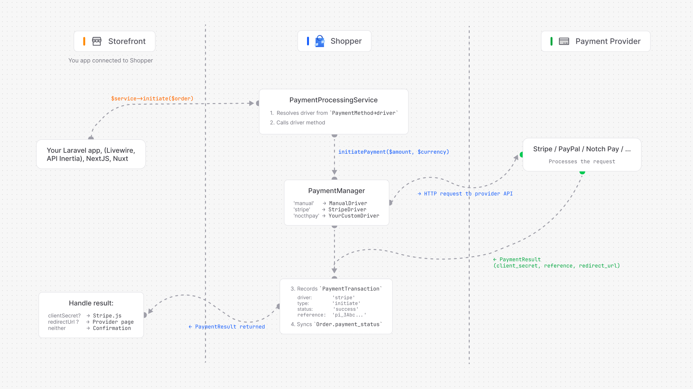
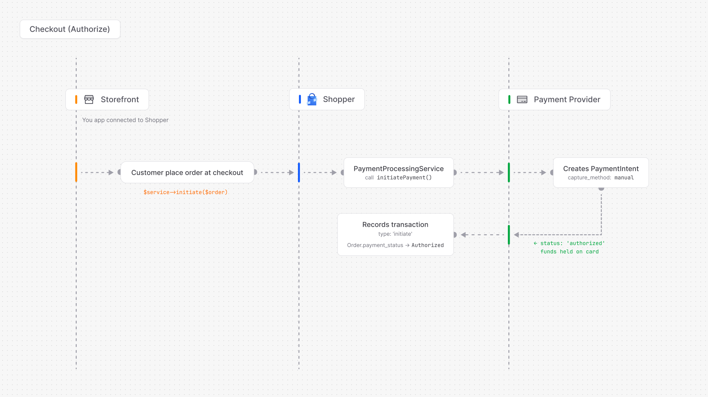
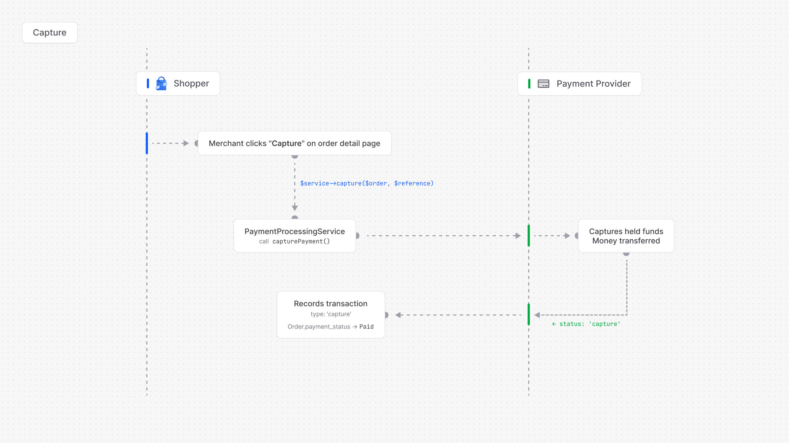

The `shopper/payment` package handles payment processing through a driver-based architecture. It sits between your storefront and payment providers, giving you a single API to initiate, authorize, capture, and refund payments, regardless of which provider you use.

Every payment operation that goes through the `PaymentProcessingService` is recorded as a transaction, whether it succeeds or fails. When an operation succeeds, the service also updates the order's payment status.

## How It Works

The payment system has four main pieces:

1. **PaymentManager** resolves payment drivers by name (`manual`, `stripe` from `shopper/stripe`, or a custom driver such as `paypal`)
2. **PaymentDriver** is the contract every provider must implement
3. **PaymentProcessingService** wraps driver calls with transaction recording and status sync
4. **PaymentTransaction** stores every operation for audit and debugging



## Payment Drivers

### Available Drivers

| Driver | Package | Code | Description |
|--------|---------|------|-------------|
| Manual | `shopper/payment` | `manual` | No API. For cash on delivery, bank transfers, etc. |
| Stripe | `shopper/stripe` | `stripe` | Stripe PaymentIntents with 3D Secure support |

`shopper/payment` is installed with the admin panel. The Stripe driver is a separate package:

```bash
composer require shopper/stripe
```

It registers the `stripe` driver and reads its settings from `config('shopper.stripe')`. Set them in your `.env`, or publish `config/shopper/stripe.php` with `php artisan vendor:publish --tag=shopper-stripe-config`:

```dotenv
STRIPE_SECRET_KEY=sk_test_...
STRIPE_PUBLISHABLE_KEY=pk_test_...
STRIPE_WEBHOOK_SECRET=whsec_...
STRIPE_CAPTURE_METHOD=manual
PAYMENT_STRIPE_ENABLED=true
```

The driver counts as configured once `STRIPE_SECRET_KEY` is set. `PAYMENT_STRIPE_ENABLED` only decides whether `Payment::configuredDrivers()` lists it.

### Using the Facade

The `Payment` facade gives you access to the driver manager:

```php
use Shopper\Payment\Facades\Payment;

$stripe = Payment::driver('stripe');

$manual = Payment::driver('manual');

$manual = Payment::driver();

Payment::availableDrivers();

Payment::configuredDrivers();

Payment::isConfigured('stripe');
```

`driver()` without a name returns the `manual` driver, and throws an `InvalidArgumentException` for a code no package registered. `availableDrivers()` returns `manual` plus every code registered with `Payment::extend()`. `configuredDrivers()` keeps `manual` and the drivers whose `shopper.payment.drivers.<code>.enabled` config is `true`. `isConfigured()` asks the driver whether its credentials are set, and returns `false` for an unknown code.

### The PaymentDriver Contract

Every driver implements `Shopper\Payment\Contracts\PaymentDriver`:

| Method | Return | Purpose |
|--------|--------|---------|
| `code()` | `string` | Unique identifier (`stripe`, `paypal`, etc.) |
| `name()` | `string` | Display name for the admin panel |
| `logo()` | `?string` | URL to the provider's logo |
| `isConfigured()` | `bool` | Whether API credentials are set |
| `supportsWebhooks()` | `bool` | Whether the driver handles webhook events |
| `supportsRefunds()` | `bool` | Whether the driver can process refunds |
| `initiatePayment(int $amount, string $currency, array $context = [])` | `PaymentResult` | Create a payment session with the provider |
| `authorizePayment(string $reference, array $data = [])` | `PaymentResult` | Confirm/authorize a payment |
| `capturePayment(string $reference, ?int $amount = null)` | `PaymentResult` | Capture funds from an authorized payment |
| `refundPayment(string $reference, int $amount, ?string $reason = null)` | `PaymentResult` | Refund a captured payment (full or partial) |
| `cancelPayment(string $reference)` | `PaymentResult` | Cancel a payment before capture |
| `retrievePayment(string $reference)` | `PaymentResult` | Check payment status from the provider |
| `handleWebhook(array $payload, array $headers = [])` | `WebhookResult` | Process an incoming webhook event |

Amounts are integers in cents.

Shopper provides an abstract `Shopper\Payment\Drivers\Driver` class. Extend it and implement `code()`, `name()`, `isConfigured()` and `initiatePayment()`. The other operations throw `PaymentException::notSupported()` until you override them, `logo()` returns `null`, and `supportsWebhooks()` and `supportsRefunds()` return `true`: override them to return `false` when your driver does not handle webhooks or refunds.

## Processing Payments

The `PaymentProcessingService` is the recommended way to process payments. It resolves the driver from the order's payment method and wraps every driver call with:
- A `PaymentTransaction` row, with the status `success` or `failed` from the driver's result
- An update of the order's `payment_status` when the operation succeeds

The service does not catch exceptions. A driver that cannot complete the call throws a `PaymentException` (`StripeException` for Stripe, for an API error or a declined card), and no transaction is recorded for that call. Wrap the calls in `try`/`catch` where your storefront must show an error.

```php
use Shopper\Payment\Services\PaymentProcessingService;

$service = app(PaymentProcessingService::class);
```

### Initiating a Payment

This is the first step in any payment flow. It creates a payment session with the provider and records an `initiate` transaction. It does not change the order's `payment_status`.

`initiate()` charges the order's `price_amount` in its `currency_code`, with the driver of the order's payment method (`manual` when the method has no driver), so set `payment_method_id` on the order first. `CreateOrderFromCartAction` fills `price_amount` with the cart total (lines, discounts and taxes), which does not include shipping.

The driver receives `order_number` and `order_id` in its context. Pass a second argument to add keys: the Stripe driver reads `payment_method`, `customer`, `metadata` and `idempotency_key`. Without an `idempotency_key`, each call creates a new PaymentIntent.

```php
$result = $service->initiate($order, [
    'idempotency_key' => 'order-'.$order->number,
]);
```

Here's how the [demo store](https://demo.laravelshopper.dev) initiates a payment at checkout:

```php
use Shopper\Payment\Services\PaymentProcessingService;

$service = resolve(PaymentProcessingService::class);
$result = $service->initiate($order);

if (! $result->success) {
    session()->flash('error', $result->message ?? 'Payment initiation failed.');

    return redirect()->route('order-confirmed', $order->number);
}

if ($result->clientSecret) {
    session()->put('stripe_payment', [
        'client_secret' => $result->clientSecret,
        'publishable_key' => $result->data['publishable_key'],
    ]);

    return redirect()->route('stripe-payment', $order->number);
}

if ($result->redirectUrl) {
    return redirect($result->redirectUrl);
}

return redirect()->route('order-confirmed', $order->number);
```

The `PaymentResult` tells you what to do next:
- **`clientSecret`** is set. Redirect the customer to a page with the Stripe.js Payment Element
- **`redirectUrl`** is set. Redirect the customer to the provider (PayPal, 3D Secure, etc.)
- **Neither**. The customer has nothing to do online. The manual driver, for example, returns the status `authorized` and a `manual_` reference: the money is collected outside Shopper (cash on delivery, bank transfer)

### Authorizing a Payment

Confirms a previously initiated payment. On success, the order's `payment_status` is updated to `Authorized`.

The Stripe driver confirms the PaymentIntent with the `payment_method` and `return_url` keys of the third argument. Pass `return_url` so that, when the bank asks for 3D Secure, `redirectUrl` holds the page to send the customer to.

```php
$result = $service->authorize($order, $reference, [
    'payment_method' => 'pm_card_visa',
    'return_url' => route('payment.callback', $order),
]);

if ($result->requiresAction()) {
    return redirect($result->redirectUrl);
}
```

### Capturing a Payment

Captures an authorized payment. This is when funds are actually collected from the customer. On success, the order's `payment_status` is updated to `Paid`. Without `amount`, the full authorized amount is captured; pass an amount in cents to capture less.

```php
$result = $service->capture($order, $reference);

$result = $service->capture($order, $reference, amount: 5000);
```

### Refunding a Payment

Refunds a captured payment. The service automatically determines whether the order becomes `PartiallyRefunded` or `Refunded` by comparing the total refunded amount against the order total.

```php
$result = $service->refund(
    order: $order,
    reference: $reference,
    amount: 2000,
    reason: 'requested_by_customer',
);
```

`amount` is required, in cents. With Stripe, `reference` is the PaymentIntent ID (`pi_...`) returned by `initiate()`, and `reason` is sent to Stripe, which only accepts `duplicate`, `fraudulent` or `requested_by_customer`. The manual driver does not support refunds (`supportsRefunds()` returns `false`) and throws a `PaymentException`.

### Cancelling a Payment

Cancels a payment that hasn't been captured yet. On success, the order's `payment_status` is updated to `Voided`. No funds are collected.

```php
$result = $service->cancel($order, $reference);
```

The manual driver does not implement `cancelPayment()` and throws a `PaymentException`.

### Querying Transactions

```php
$transactions = $service->getTransactions($order);

$reference = $service->getLatestReference($order);
```

`getTransactions()` returns the order's transactions, newest first. `getLatestReference()` returns the reference of the order's latest successful transaction, or `null`. After a Stripe refund, that reference is the refund ID (`re_...`), not the PaymentIntent.

### Getting Available Payment Methods for a Zone

The service returns the zone's enabled payment methods whose driver is configured (a method without a driver uses `manual`, which is always configured):

```php
$methods = $service->getMethodsForZone($zone);
```

This is used at checkout to show only the payment methods available in the customer's region. `getLogoUrl()` returns the logo of the method's driver. Here's how the demo store loads payment methods:

```php
use Shopper\Core\Models\PaymentMethod;
use Shopper\Core\Models\Zone;
use Shopper\Payment\Services\PaymentProcessingService;

$zone = Zone::query()
    ->whereHas('countries', fn ($q) => $q->where('id', $countryId))
    ->where('is_enabled', true)
    ->first();

$service = resolve(PaymentProcessingService::class);

$paymentMethods = $service->getMethodsForZone($zone)
    ->map(fn (PaymentMethod $method) => [
        'id' => $method->id,
        'title' => $method->title,
        'description' => $method->description,
        'logo' => $service->getLogoUrl($method),
    ])
    ->values()
    ->all();
```

## Data Transfer Objects

### PaymentResult

Every driver operation returns a `PaymentResult`. This is an immutable object that carries the outcome of the operation.

```php
use Shopper\Payment\DataTransferObjects\PaymentResult;

$result->success;       // Did the operation succeed?
$result->status;        // Status set by the driver (pending, requires_action, authorized, captured, canceled, failed, etc.)
$result->reference;     // Provider reference ID (Stripe PaymentIntent ID, etc.)
$result->clientSecret;  // For frontend SDKs (Stripe.js, etc.)
$result->redirectUrl;   // For 3D Secure, PayPal redirect, etc.
$result->amount;        // Amount in cents
$result->message;       // Error message on failure
$result->data;          // Extra driver data (Stripe: stripe_status, publishable_key, etc.)

$result->requiresAction();  // True when redirectUrl is set or the status is requires_action
$result->toArray();         // Convert to array for JSON responses

PaymentResult::failed('Card declined', $reference);
```

### WebhookResult

Webhook handlers return a `WebhookResult` that tells you what happened on the provider side:

```php
use Shopper\Payment\DataTransferObjects\WebhookResult;

$result->action;     // What happened: authorized, captured, failed, canceled, refunded, ignored
$result->reference;  // Provider reference ID
$result->amount;     // Amount in cents
$result->data;       // Additional event data

$result->isIgnored();     // True for unhandled event types
$result->toArray();       // Convert to array
WebhookResult::ignored(); // Create an ignored result
```

Shopper 2.x does not register a webhook route and does not update orders from webhooks: your app receives the request, passes it to the driver, and acts on the result. The Stripe driver verifies the signature with `STRIPE_WEBHOOK_SECRET`. It needs the raw request body under the `_raw_body` key and the `stripe-signature` header as a string, and throws a `StripeException` when either is missing or the signature does not match. For a PaymentIntent event, `reference` is the PaymentIntent ID, the same reference as the order's `initiate` transaction:

```php
namespace App\Http\Controllers;

use Illuminate\Http\Request;
use Illuminate\Http\Response;
use Shopper\Core\Enum\PaymentStatus;
use Shopper\Payment\Exceptions\PaymentException;
use Shopper\Payment\Facades\Payment;
use Shopper\Payment\Models\PaymentTransaction;

final class StripeWebhookController
{
    public function __invoke(Request $request): Response
    {
        try {
            $result = Payment::driver('stripe')->handleWebhook(
                payload: ['_raw_body' => $request->getContent()],
                headers: ['stripe-signature' => (string) $request->header('Stripe-Signature')],
            );
        } catch (PaymentException) {
            return response('Invalid payload', 400);
        }

        if ($result->isIgnored()) {
            return response('Ignored');
        }

        $order = PaymentTransaction::query()
            ->where('reference', $result->reference)
            ->first()
            ?->order;

        $status = match ($result->action) {
            'authorized' => PaymentStatus::Authorized,
            'captured' => PaymentStatus::Paid,
            'canceled' => PaymentStatus::Voided,
            default => null,
        };

        if ($order !== null && $status !== null) {
            $order->update(['payment_status' => $status]);
        }

        return response('OK');
    }
}
```

The Stripe driver maps `payment_intent.amount_capturable_updated` to `authorized`, `payment_intent.succeeded` to `captured`, `payment_intent.payment_failed` to `failed`, `payment_intent.canceled` to `canceled`, and `charge.refunded` to `refunded`, where `amount` is the total refunded on the charge. Every other event is `ignored`.

## Payment Status

The `PaymentStatus` enum on the Order model tracks the overall payment state. It is updated automatically by the `PaymentProcessingService` as transactions succeed.

```php
use Shopper\Core\Enum\PaymentStatus;

PaymentStatus::Pending             // Awaiting payment
PaymentStatus::Authorized          // Funds held, not yet captured
PaymentStatus::Paid                // Funds collected
PaymentStatus::PartiallyRefunded   // Some amount refunded
PaymentStatus::Refunded            // Full amount refunded
PaymentStatus::Voided              // Cancelled before capture
```

### Status Transitions

The service sets the status from the operation that succeeded, without checking the current status. `initiate` and failed operations leave it unchanged. A payment the customer confirms with Stripe.js changes nothing on the order until your code calls the service or handles the [webhook](/2.x/payments#webhookresult).

In the admin panel, the **Mark as paid** action of a pending or authorized order sets `Paid` directly: it does not call the driver and records no transaction. On an authorized Stripe payment, use **Capture payment** instead: once the order is `Paid`, the capture action is hidden and Shopper never captures the authorization.

| From | To | When |
|------|----|------|
| Pending | Authorized | `authorize` succeeds |
| Pending | Paid | `capture` succeeds on an order never authorized through the service (payment confirmed with Stripe.js, manual driver) |
| Pending | Voided | `cancel` succeeds |
| Authorized | Paid | `capture` succeeds |
| Authorized | Voided | `cancel` succeeds |
| Paid | Partially Refunded | Partial `refund` succeeds |
| Paid | Refunded | Full `refund` succeeds |
| Partially Refunded | Refunded | Remaining amount refunded |

## Transaction Model

Every payment operation is recorded as a `PaymentTransaction`:

```php
Shopper\Payment\Models\PaymentTransaction
```

### Database Schema

The table is `payment_transactions`, with the [table prefix](/2.x/configuration#database-table-prefix).

| Column | Type | Description |
|--------|------|-------------|
| `id` | bigint | Primary key |
| `driver` | string | Driver code (`stripe`, `manual`, etc.) |
| `type` | string | Operation type (initiate, authorize, capture, refund, cancel) |
| `status` | string | Result (pending, success, failed) |
| `amount` | integer | Amount in cents |
| `currency_code` | string(3) | ISO currency code |
| `reference` | string | Provider reference ID (nullable, indexed) |
| `data` | json | The `data` of the driver's `PaymentResult` (nullable) |
| `notes` | text | The `message` of the driver's `PaymentResult`, such as the failure reason (nullable) |
| `metadata` | json | Custom data (nullable) |
| `order_id` | bigint | FK to order (nullable, set to null when the order is deleted) |
| `payment_method_id` | bigint | FK to payment method (nullable, set to null when the method is deleted) |
| `created_at` | timestamp | Creation timestamp |
| `updated_at` | timestamp | Last update timestamp |

### Enums

```php
use Shopper\Payment\Enum\TransactionType;

TransactionType::Initiate   // Payment session created
TransactionType::Authorize  // Payment authorized
TransactionType::Capture    // Funds collected
TransactionType::Refund     // Funds returned
TransactionType::Cancel     // Payment voided
```

```php
use Shopper\Payment\Enum\TransactionStatus;

TransactionStatus::Pending  // In progress
TransactionStatus::Success  // Completed
TransactionStatus::Failed   // Failed
```

### Querying Transactions

```php
use Shopper\Payment\Enum\TransactionType;
use Shopper\Payment\Models\PaymentTransaction;

PaymentTransaction::query()->successful()->get();

PaymentTransaction::query()->forDriver('stripe')->get();

PaymentTransaction::query()->ofType(TransactionType::Capture)->get();

$order->paymentTransactions;

$transaction->isSuccessful();
$transaction->order;
$transaction->paymentMethod;
```

The `paymentTransactions` relationship is registered automatically when the payment package is installed.

## Capture Methods

Shopper supports two capture strategies. This determines _when_ the customer's funds are actually collected. The Stripe driver reads its strategy from `config('shopper.stripe.capture_method')` (`STRIPE_CAPTURE_METHOD`): `manual` (the default) or `automatic`.

### Manual Capture (Authorize-then-Capture)

Recommended for physical goods. Funds are held on the customer's card at checkout but only collected when you decide to capture.



This gives you the flexibility to:
- Verify stock availability before collecting payment
- Cancel an order without processing a refund (and without refund fees)
- Capture only when the order is ready to ship

When the order is ready to ship, the merchant captures the payment from the admin panel. The "Capture payment" action on the order page shows when the order's `payment_status` is `authorized` and the user has the `edit_orders` permission. It captures the full amount on the reference returned by `getLatestReference()`:



### Automatic Capture

Funds are collected immediately when the customer confirms payment. Use this for digital products, subscriptions, or when fulfillment is instant.

<Note>
Manual capture is the default for the Stripe driver. Authorization holds typically last 7 days (varies by card network), so you must capture within that window or the hold is released automatically.
</Note>

## Custom Drivers

You can create drivers for any payment provider: PayPal, Mollie, Razorpay, NotchPay, etc.

### Step 1: Create the Driver Class

Extend the abstract `Driver` class and implement the methods your provider supports:

```php
namespace App\Payment\Drivers;

use Illuminate\Support\Facades\Http;
use Shopper\Payment\DataTransferObjects\PaymentResult;
use Shopper\Payment\DataTransferObjects\WebhookResult;
use Shopper\Payment\Drivers\Driver;
use Shopper\Payment\Exceptions\PaymentException;

final class PayPalDriver extends Driver
{
    public function __construct(
        private readonly string $clientId,
        private readonly string $clientSecret,
        private readonly bool $sandbox = false,
    ) {}

    public function code(): string
    {
        return 'paypal';
    }

    public function name(): string
    {
        return 'PayPal';
    }

    public function logo(): string
    {
        return asset('images/payments/paypal.svg');
    }

    public function isConfigured(): bool
    {
        return filled($this->clientId) && filled($this->clientSecret);
    }

    public function initiatePayment(int $amount, string $currency, array $context = []): PaymentResult
    {
        if (! $this->isConfigured()) {
            throw PaymentException::notConfigured('paypal');
        }

        $response = Http::withToken($this->getAccessToken())
            ->post($this->baseUrl().'/v2/checkout/orders', [
                'intent' => 'AUTHORIZE',
                'purchase_units' => [[
                    'amount' => [
                        'currency_code' => mb_strtoupper($currency),
                        'value' => number_format($amount / 100, 2, '.', ''),
                    ],
                    'reference_id' => $context['order_number'] ?? null,
                ]],
            ]);

        if ($response->failed()) {
            throw PaymentException::apiError('paypal', $response->body());
        }

        $data = $response->json();

        $approveUrl = collect($data['links'])
            ->firstWhere('rel', 'approve')['href'] ?? null;

        return new PaymentResult(
            success: true,
            status: 'pending',
            reference: $data['id'],
            redirectUrl: $approveUrl,
            amount: $amount,
        );
    }

    public function capturePayment(string $reference, ?int $amount = null): PaymentResult
    {
        $response = Http::withToken($this->getAccessToken())
            ->post($this->baseUrl()."/v2/checkout/orders/{$reference}/capture");

        if ($response->failed()) {
            throw PaymentException::apiError('paypal', $response->body());
        }

        $data = $response->json();

        return new PaymentResult(
            success: $data['status'] === 'COMPLETED',
            status: 'captured',
            reference: $reference,
            amount: $amount,
        );
    }

    public function handleWebhook(array $payload, array $headers = []): WebhookResult
    {
        return match ($payload['event_type'] ?? '') {
            'PAYMENT.CAPTURE.COMPLETED' => new WebhookResult(
                action: 'captured',
                reference: $payload['resource']['supplementary_data']['related_ids']['order_id'] ?? null,
                amount: (int) round((float) ($payload['resource']['amount']['value'] ?? 0) * 100),
            ),
            default => WebhookResult::ignored(),
        };
    }

    private function baseUrl(): string
    {
        return $this->sandbox
            ? 'https://api-m.sandbox.paypal.com'
            : 'https://api-m.paypal.com';
    }

    private function getAccessToken(): string
    {
        return Http::asForm()
            ->withBasicAuth($this->clientId, $this->clientSecret)
            ->post($this->baseUrl().'/v1/oauth2/token', ['grant_type' => 'client_credentials'])
            ->json('access_token');
    }
}
```

The example keeps `handleWebhook()` short and skips the signature check. A production driver must verify the provider's signature first and throw `PaymentException::webhookVerificationFailed('paypal')` when it does not match.

### Step 2: Register the Driver

In a service provider, use `Payment::extend()` to register your driver. The closure is called lazily, only when the driver is first accessed. Once registered, the driver is listed by `Payment::availableDrivers()` and in the driver select of the admin payment methods settings.

```php
namespace App\Providers;

use App\Payment\Drivers\PayPalDriver;
use Illuminate\Support\ServiceProvider;
use Shopper\Payment\Facades\Payment;

class PaymentServiceProvider extends ServiceProvider
{
    public function boot(): void
    {
        Payment::extend('paypal', fn (): PayPalDriver => new PayPalDriver(
            clientId: (string) config('shopper.payment.drivers.paypal.credentials.client_id'),
            clientSecret: (string) config('shopper.payment.drivers.paypal.credentials.client_secret'),
            sandbox: (bool) config('shopper.payment.drivers.paypal.sandbox', false),
        ));
    }
}
```

### Step 3: Add Configuration

Add the driver credentials under `drivers` in `config/shopper/payment.php`. The file is published by `php artisan shopper:install`, or by `php artisan vendor:publish --tag=shopper-config`, and already ships a `paypal` entry:

```php
'drivers' => [
    'paypal' => [
        'enabled' => env('PAYMENT_PAYPAL_ENABLED', false),
        'sandbox' => env('PAYMENT_SANDBOX', false),
        'credentials' => [
            'client_id' => env('PAYPAL_CLIENT_ID'),
            'client_secret' => env('PAYPAL_CLIENT_SECRET'),
            'webhook_id' => env('PAYPAL_WEBHOOK_ID'),
        ],
    ],
],
```

The `enabled` key decides whether `Payment::configuredDrivers()` lists the driver.

And in your `.env`:

```dotenv
PAYMENT_PAYPAL_ENABLED=true
PAYMENT_SANDBOX=true
PAYPAL_CLIENT_ID=your-client-id
PAYPAL_CLIENT_SECRET=your-client-secret
```

### Step 4: Create the Payment Method

Link the driver to a payment method record. This is what makes it selectable at checkout:

```php
use Shopper\Core\Models\PaymentMethod;

$paypal = PaymentMethod::query()->create([
    'title' => 'PayPal',
    'slug' => 'paypal',
    'driver' => 'paypal',
    'description' => 'Pay with your PayPal account.',
    'is_enabled' => true,
]);

$paypal->zones()->attach($zone);
```

`getMethodsForZone()` only returns the methods attached to the zone. The `driver` column connects this payment method to your registered driver. When a customer selects "PayPal" at checkout and the `PaymentProcessingService` processes the order, it resolves the `paypal` driver and calls `initiatePayment()`.

## Payment Method Model

The `Shopper\Core\Models\PaymentMethod` model represents a payment option available at checkout. Each method is linked to a driver (`manual`, `stripe` once `shopper/stripe` is installed, or a [custom driver](/2.x/payments#custom-drivers) such as the PayPal one above) and can be scoped to specific [zones](/2.x/zones).

| Column | Type | Nullable | Description |
|--------|------|----------|-------------|
| `id` | bigint | no | Primary key |
| `title` | string | no | Display name |
| `slug` | string | yes | URL-friendly identifier (unique) |
| `logo` | string | yes | Logo path. The admin and `getLogoUrl()` show the driver's logo instead |
| `driver` | string | yes | Driver code linking to a registered payment driver (`null` means `manual`) |
| `is_enabled` | boolean | no | Whether the method is active (default `false`) |
| `description` | text | yes | Description shown at checkout |
| `link_url` | string | yes | External payment URL |
| `instructions` | text | yes | Post-purchase instructions |
| `metadata` | jsonb | yes | Additional custom data |

The model uses the `HasSlug` trait and the `HasZones` trait for zone-based availability. `HasSlug` turns the slug you set into a unique slug (`paypal`, then `paypal-1`):

```php
use Shopper\Core\Models\PaymentMethod;

PaymentMethod::query()->enabled()->get();

$method = PaymentMethod::findBySlug('paypal');

$method->zones;
$method->zones()->attach([$zoneId1, $zoneId2]);
```

## Storefront Checkout Example

Here is a complete checkout flow showing how the demo store creates an order and processes payment.

### Checkout Session

The checkout wizard stores each step's data in the session:

```php
final class CheckoutSession
{
    public const string KEY = 'checkout';

    public const string SHIPPING_ADDRESS = 'checkout.shipping_address';

    public const string BILLING_ADDRESS = 'checkout.billing_address';

    public const string SAME_AS_SHIPPING = 'checkout.same_as_shipping';

    public const string SHIPPING_OPTION = 'checkout.shipping_option';

    public const string PAYMENT = 'checkout.payment';
}
```

### Creating the Order

After the customer completes the checkout steps, convert the [cart to an order](/2.x/cart#converting-to-order) and set the payment method:

```php
use Shopper\Cart\Actions\CreateOrderFromCartAction;
use Shopper\Cart\Facades\Cart;

$order = resolve(CreateOrderFromCartAction::class)->execute(Cart::current());

$order->update([
    'payment_method_id' => session('checkout.payment.0.id'),
    'shipping_option_id' => session('checkout.shipping_option.0.id'),
]);

Cart::forget();
```

### Processing the Payment

Once the order exists, initiate the payment and handle the result:

```php
use Shopper\Payment\Services\PaymentProcessingService;

$service = resolve(PaymentProcessingService::class);
$result = $service->initiate($order);

session()->forget(CheckoutSession::KEY);

if ($result->clientSecret) {
    session()->put('stripe_payment', [
        'client_secret' => $result->clientSecret,
        'publishable_key' => $result->data['publishable_key'],
    ]);

    return redirect()->route('stripe-payment', $order->number);
}

if ($result->redirectUrl) {
    return redirect($result->redirectUrl);
}

return redirect()->route('order-confirmed', $order->number);
```

### Routes

```php
use App\Http\Controllers\StripeWebhookController;

Route::middleware('auth')->group(function (): void {
    Route::get('/checkout', Checkout::class)->name('checkout');
    Route::get('/payment/{number}', StripePayment::class)->name('stripe-payment');
    Route::get('/order/confirmed/{number}', OrderConfirmed::class)->name('order-confirmed');
});

Route::post('/webhooks/stripe', StripeWebhookController::class);
```

Stripe cannot send a CSRF token, so exclude the webhook route from CSRF verification in `bootstrap/app.php`:

```php
use Illuminate\Foundation\Configuration\Middleware;

->withMiddleware(function (Middleware $middleware): void {
    $middleware->validateCsrfTokens(except: [
        'webhooks/stripe',
    ]);
})
```
