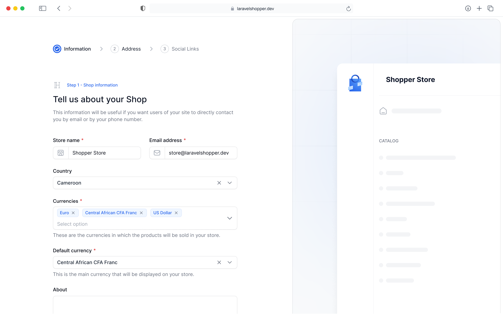
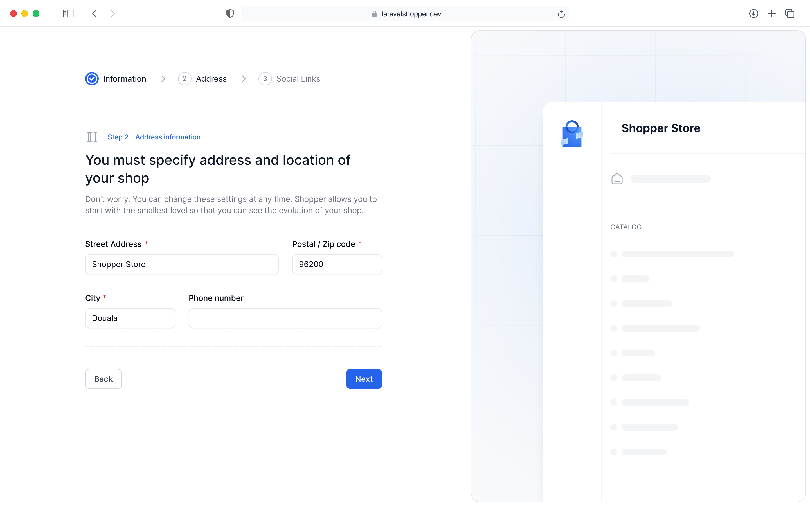
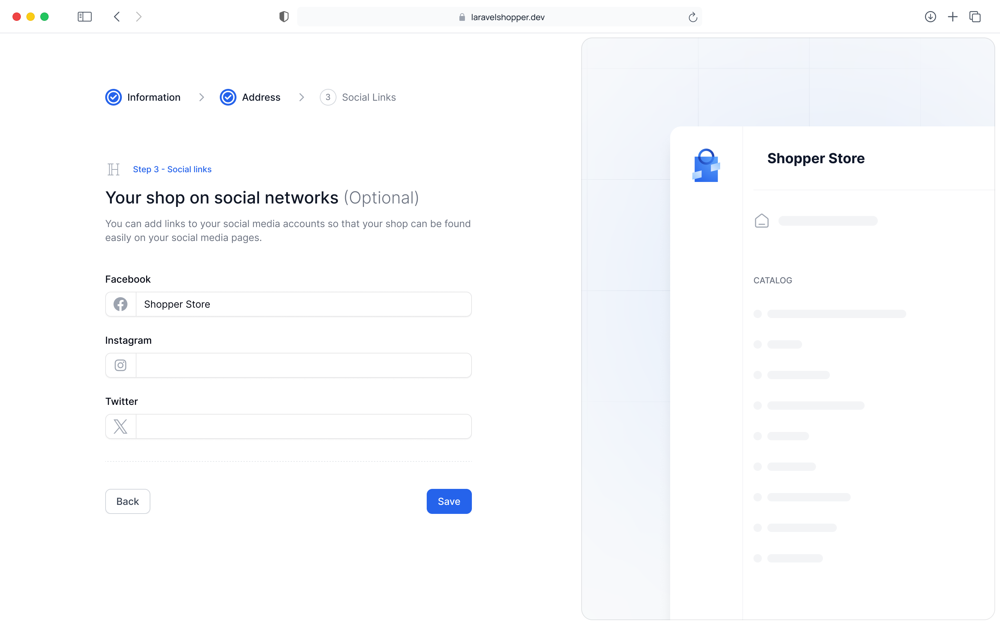
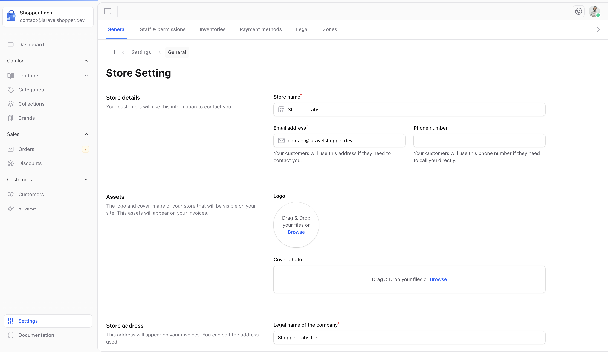

After installing Shopper and creating your admin user, log in at `/cpanel/login` (`cpanel` is the default value of `shopper.admin.prefix`, set with `SHOPPER_PREFIX`). Until the store has an `email` and a `street_address` setting, every admin page redirects to the setup wizard at `/cpanel/initialize`. Only an administrator or a user with the `access_setting` permission can complete it.

The wizard collects your store's basic information, address, and social links in three steps. Clicking **Next** saves the fields of the current step. Clicking **Save** on the last step saves every field, creates your first inventory location in the same database transaction, and opens the dashboard. The wizard does not create the default sales channel: the install command does, as described in [Channel](#channel).

## Settings Model

Store configuration is managed through key-value pairs in the `Shopper\Core\Models\Setting` model, stored in the `sh_settings` table (`sh_` is the default [table prefix](/2.x/configuration#database-table-prefix)). Each setting has a unique key, an optional display name, and a JSON value.

### Database Schema

| Column | Type | Nullable | Default | Description |
|--------|------|----------|---------|-------------|
| `id` | bigint | no | auto | Primary key |
| `key` | string | no | - | Configuration key (unique) |
| `display_name` | string | yes | null | Human-readable label. Shopper sets it from the key each time it saves the setting |
| `value` | json | yes | null | Setting value, stored as JSON and decoded on read (`array` cast): a list of IDs comes back as an array, a store name as a string |
| `locked` | boolean | no | false | Set to `true` by every admin save except the wizard's **Next** button, which saves with `false` and skips settings that are already locked. Hidden from the model's array and JSON output |
| `created_at` | timestamp | yes | null | Creation timestamp |
| `updated_at` | timestamp | yes | null | Last update timestamp |

### Retrieving Settings

To retrieve the value of a key, call the `shopper_setting()` helper with the key. It returns `null` when the key does not exist:

```php
shopper_setting('name');
```

The value is cached for one day under the key `shopper-setting.{$key}`. Shopper clears that cache entry each time the admin panel saves the key. The second parameter, `withCache`, defaults to `true`. With `false`, the value read from the database is cached for one second instead of one day, but a value already in the cache is still returned:

```php
shopper_setting('name', withCache: false);
```

If you change a `Setting` row in your own code, forget its cache entry so the next call reads the new value. For `default_currency_id`, also forget `shopper-setting.default_currency`, where `shopper_currency()` keeps the currency code for one hour:

```php
use Illuminate\Support\Facades\Cache;
use Shopper\Core\Models\Setting;

Setting::query()->updateOrCreate(
    ['key' => 'email'],
    ['value' => 'orders@acme-store.com'],
);

Cache::forget('shopper-setting.email');
```

## Store

When you launch your store the first important thing to do is to fill in the information about this store.
Your customers and the different services you might use need to know the information about your store.

<Frame>
  
</Frame>

The information stored in this section is available using the following keys:
- `name` the store name (required, 100 characters at most)
- `email` the store email (required)
- `country_id` the ID of the country where the store is based (optional)
- `currencies` an array of the IDs of the currencies the store sells in (at least one). The price forms of the admin list these currencies, see [How Setup Store Currencies](/2.x/currencies#how-setup-store-currencies)
- `default_currency_id` the ID of the default currency, which must be one of `currencies`. `shopper_currency()` returns its code, or `USD` when it is not set

The store description (`about`) is not part of the wizard: you fill it in on the General settings page, described in [Update setting](#update-setting).

## Address

Most stores keep their products in different locations around the world. When setting up this configuration you need to
define an address that will be set as the default location for your products.

When you submit the wizard, Shopper creates your default inventory location from this step: the location takes the store name (and its slug as the location code), the store email, the street address, postal code, city, phone number and country. When you create a product or a variant in the admin with an initial quantity, that stock is recorded at the default location. See [Default Location](/2.x/locations#default-location).

<Frame>
  
</Frame>

The keys registered in database during this section: `street_address`, `postal_code` and `city` (required), `state` and `phone_number` (optional).

## Social Links

If you want your customers to find you easily on social networks, you can fill in all the links directly by putting the full url. The wizard checks that each link is a valid URL.

This step is completely optional

<Frame>
  
</Frame>

The keys registered in the database during this section: `facebook_link`, `instagram_link` and `twitter_link`.

<Note>
The setup wizard (`Shopper\Livewire\Pages\Initialization` and its `Shopper\Livewire\Components\Initialization\InitializationWizard` form) is registered by Shopper itself and has no entry in the component configuration files, so you cannot replace it. It is a mandatory step before accessing the dashboard, see [Access Requirements](/2.x/dashboard#access-requirements).
</Note>

## Channel

In today's E-commerce the shop site is no longer the only point of sale. Channels represent a single sales channel,
which can be one of the following things:

- Website
- Mobile application
- Cashier in your physical store
- Facebook shop,
- Instagram shop,
- etc

or pretty much anything similar you can imagine. When you accept the database step of `php artisan shopper:install`, the `ChannelSeeder` creates a default sales channel. The setup wizard does not create or change it, and the channel does not take your store address. The seeder runs the equivalent of:

```php
use Shopper\Core\Models\Channel;

Channel::query()->create([
    'name' => 'Web Store',
    'slug' => 'web-store',
    'url' => config('app.url'),
    'is_default' => true,
    'is_enabled' => true,
]);
```

The **Add product** form of the admin preselects this channel in its **Sales channels** field, and you can remove it there. A product you create in code has no channel until you attach one, see [Assigning Products to Channels](/2.x/channels#assigning-products-to-channels). The 2.x admin has no page to manage channels: create other channels in code, as shown in [Creating Channels](/2.x/channels#creating-channels).

## Update setting

You can update your store information when needed, edit your store images, update the complete address, the legal name of your shop, etc.
To edit your shop information:

- In the admin, click **Settings** at the bottom of the sidebar, then **General** (`/cpanel/setting/general`). Both require the `access_setting` permission.

Besides the wizard keys, this page saves `legal_name` (required), `about` (the store description, from a rich text editor), and `logo` and `cover` (the paths of the uploaded images on the `shopper.media.storage.disk_name` disk).

The component used to update store setting of the store is found in the component configuration file `config/shopper/components/setting.php` if published (run `php artisan shopper:component:publish setting`).
It's the `Shopper\Livewire\Pages\Settings\General` component under the key `pages.general`.

```php
use Shopper\Livewire\Components;
use Shopper\Livewire\Pages;

return [
    'pages' => [
        'setting-index' => Pages\Settings\Index::class,
        'general' => Pages\Settings\General::class,
        'location-index' => Pages\Settings\Locations\Index::class,
        // ...
    ],

    'components' => [
        // ...
    ],
];
```

<Frame>
  
</Frame>

In this interface you will update your store. Don't forget that the model used is the model `Shopper\Core\Models\Setting`.
Point `pages.general` to your own Livewire component to change this view and the keys it stores in the database. To save settings the way Shopper does, use the `Shopper\Traits\SaveSettings` trait in your component: its `saveSettings()` method writes the keys and clears their cache.
