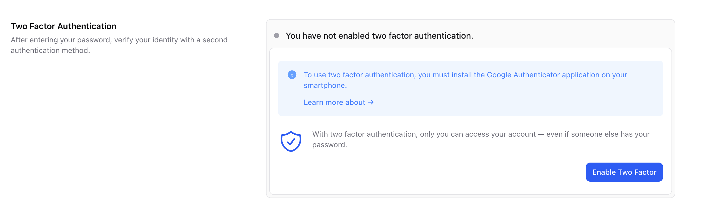
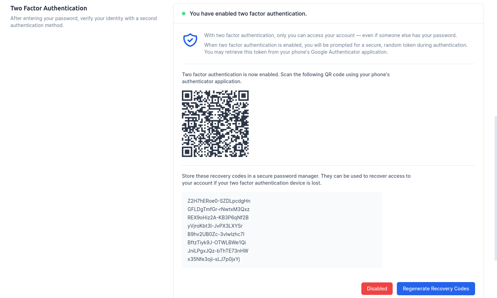
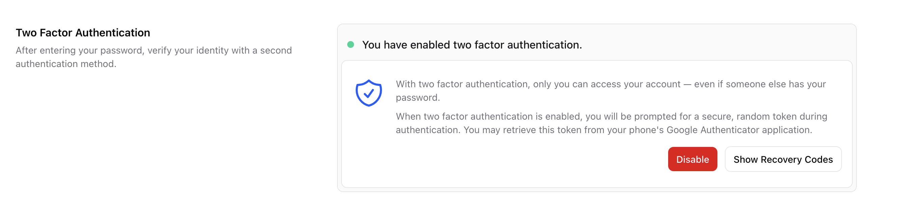

Secure your account with two-step authentication.
Two-step authentication (also known as two-factor authentication or multifactor authentication) provides a more secure login process. When you attempt to sign in, you need to complete two separate steps:

- Enter your email and password.
- Enter the code shown by an authenticator app on your mobile device.

These two steps make it much more difficult for an unauthorized person to access your account.
Even if they are able to find your password, they will not be able to connect without the second step.
Authentication in two steps combines two factors among something you know (such as your email and password),
something you have (such as a one-time code from an authenticator app) and something you are (biometric
authentication, such as a fingerprint). Shopper uses the first two: your password and a code from an authenticator app.

Every admin user can turn on two-step authentication, but only for their own account: the store owner cannot turn it on for staff members.
If several employees manage your store, each of them turns it on from their own profile.

## Configuration

Two-factor authentication must be enabled in your configuration before the feature becomes available in the UI.
In the `config/shopper/auth.php` file, the `2fa_enabled` option reads the `SHOPPER_ENABLED_TWO_FACTOR` environment variable and is `false` by default:

```php title="config/shopper/auth.php"
'2fa_enabled' => env('SHOPPER_ENABLED_TWO_FACTOR', false),
```

Turn it on in your `.env` file:

```dotenv
SHOPPER_ENABLED_TWO_FACTOR=true
```

When this option is `false`, the two-factor authentication section does not appear on the account page
and the login flow does not prompt for a second factor, even if a user has previously configured it.

Your user model must also implement the contracts described in [Interfaces and Traits](/2.x/two-factor#interfaces-and-traits).
Without `HasStoreAuthentication`, the section stays hidden and the login never asks for a code, whatever the value of `2fa_enabled`.

## Enabling Two-Factor Authentication

To enable two-step authentication, you'll need first to download an authenticator app to your mobile device.
The app will be able to scan QR codes and retrieve authentication data for you. Recommended authenticator apps:

- [Google Authenticator](https://support.google.com/accounts/answer/1066447)
- [Duo Mobile](https://guide.duo.com/third-party-accounts)
- [Amazon AWS MFA](https://aws.amazon.com/iam/details/mfa)
- [Authenticator](https://www.microsoft.com/store/p/microsoft-authenticator/9nblgggzmcj6)

In addition, you should store the listed recovery codes in a secure password manager such as [1Password](https://1password.com).

When you install an authenticator app, make sure that you follow its instructions carefully.
After your app is successfully downloaded and set up, you can activate the feature in Shopper.

From your administrator interface, click your profile picture in the upper right corner, then click **Personal Account**.

Scroll to the **Two Factor Authentication** section and click **Enable Two Factor**. A modal asks you to confirm your password.

<Frame>
  
</Frame>

Enter your current password and click **Confirm**. If you confirmed your password recently, within the `password_timeout` delay set in `config/auth.php`, Shopper skips the modal.

Shopper turns two-factor authentication on as soon as you confirm, and shows a QR code and eight recovery codes.
Scan the QR code with your authenticator app right away: the section shows it only this once, and your next login asks for a code from the app.
Store the recovery codes in your password manager.

If the user loses access to their mobile device, the login page will allow them to authenticate using one of their recovery codes instead of the temporary token provided by their mobile device's authenticator application.

<Frame>
  
</Frame>

Later, **Show Recovery Codes** displays your current recovery codes again and **Regenerate Recovery Codes** replaces all eight with new ones.
Both ask for your password, like **Enable Two Factor**.

Now when you try to log in, two-factor authentication will require your mobile device.

## Logging in with Two-Factor Authentication

Go to the Shopper administration login page and enter your email address and password. Click the **Login** button.
The login form will switch to a two-factor challenge, prompting you to enter your authentication code.

If you used a two-factor authentication app, open it and enter the code displayed, then click **Login**.

If you can't access your authenticator app, click **Use a recovery code** and enter one of your saved recovery codes to authenticate.
Each recovery code works once. After you use one, Shopper replaces it with a new code: click **Show Recovery Codes** on your profile to see the updated list.

After a password reset, a user with two-factor authentication is sent back to the login page and goes through the challenge, instead of being signed in directly.

## Disable Two-Factor Authentication

From your administrator interface, click your profile picture in the upper right corner, then click **Personal Account**.

In the **Two Factor Authentication** section, click **Disable**. Enter your password in the confirmation modal and click **Confirm**.
Shopper deletes your secret and your recovery codes: to turn two-factor authentication back on later, you scan a new QR code.

<Frame>
  
</Frame>

## Developer Integration

### Interfaces and Traits

Two-factor authentication is implemented through two focused interfaces (following the Interface Segregation Principle):

**`Shopper\Contracts\HasStoreAuthentication`** manages the TOTP secret and QR code:
- `getStoreAuthenticationSecret(): ?string`
- `saveStoreAuthenticationSecret(?string $secret): void`
- `getStoreAuthenticationHolderName(): string`
- `getStoreAuthenticationQrCodeSvg(): string`
- `getStoreAuthenticationQrCodeUrl(): string`

**`Shopper\Contracts\HasStoreAuthenticationRecovery`** manages recovery codes:
- `getStoreAuthenticationRecoveryCodes(): ?array`
- `saveStoreAuthenticationRecoveryCodes(?array $codes): void`
- `replaceStoreAuthenticationRecoveryCode(string $code): void`

The default implementation is provided by two traits. The account page uses both interfaces, so add both to the user model from [Prepare Your User Model](/2.x/installation#prepare-your-user-model):

```php title="app/Models/User.php"
use Illuminate\Foundation\Auth\User as Authenticatable;
use Shopper\Contracts\HasStoreAuthentication;
use Shopper\Contracts\HasStoreAuthenticationRecovery;
use Shopper\Models\Contracts\ShopperUser;
use Shopper\Traits\InteractsWithShopper;
use Shopper\Traits\InteractsWithStoreAuthentication;
use Shopper\Traits\InteractsWithStoreAuthenticationRecovery;

class User extends Authenticatable implements ShopperUser, HasStoreAuthentication, HasStoreAuthenticationRecovery
{
    use InteractsWithShopper;
    use InteractsWithStoreAuthentication;
    use InteractsWithStoreAuthenticationRecovery;
}
```

The traits encrypt the secret and the recovery codes before saving them. `getStoreAuthenticationHolderName()` returns the user's email: the authenticator app lists the account under `config('app.name')` and that email. Override the method to show another name.

Shopper generates the secret, builds the QR code URL and checks the codes through `Shopper\Contracts\TwoFactorAuthenticationProvider`, bound in the container to an implementation based on `pragmarx/google2fa`. Bind your own class to this contract in a service provider to use another TOTP library.

Enabling two-factor authentication dispatches the `Shopper\Events\TwoFactor\TwoFactorAuthenticationEnabled` event, with the user in its `$user` property.

### Database Columns

The following columns are added to the `users` table by Shopper's migrations:

| Column | Type | Description |
|---|---|---|
| `store_two_factor_secret` | text (nullable) | Encrypted TOTP secret |
| `store_two_factor_recovery_codes` | text (nullable) | Encrypted JSON array of recovery codes |

There is no confirmation column: two-factor authentication is on as soon as the secret is saved.
A database that still has the older `two_factor_secret` and `two_factor_recovery_codes` columns gets them renamed by the `rename_two_factor_columns_on_users_table` migration when you run `php artisan migrate`.
