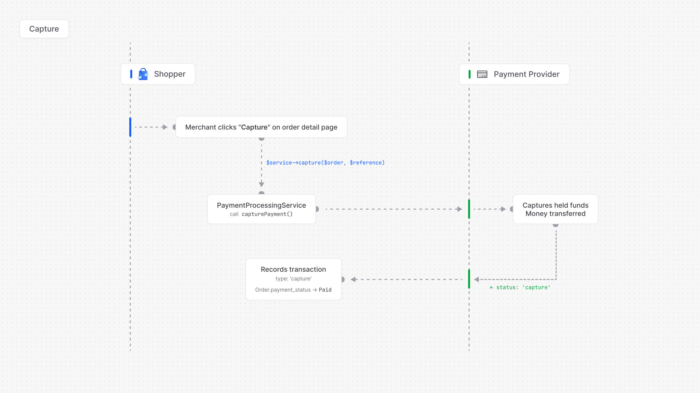

The `shopper/payment` package moves the money of an order through payment drivers. A driver talks to one payment provider: `manual` ships with the package for cash on delivery and bank transfers, the [Stripe driver](/3.x/payments/stripe) adds `stripe`, and your application can register its own. Your code and the Store API call the same methods to initiate, authorize, capture, refund and cancel a payment, whatever the provider.

Every operation is recorded as a transaction and moves the payment status of the order. What the provider reports later, through its webhooks or when Shopper asks for the state of a payment, goes through the same code, so a late or repeated event never moves an order backwards. The `PaymentMethod` model that merchants configure, and the zones where each method is offered, are described on [Payment Methods](/3.x/payment-methods).

## How It Works

The payment system has five pieces:

1. `PaymentManager`, behind the `Payment` facade, resolves a driver by its code (`manual`, `stripe` or your own).
2. `PaymentDriver` is the contract every driver implements.
3. `PaymentProcessingService` calls the driver for an order, records a transaction and moves the payment status.
4. `PaymentTransaction` stores every operation on an order, with its result and the provider reference.
5. `PaymentWebhookEvent` journals the events a provider reports, so that each one is applied once, even when it arrives before its order exists.

A storefront built on the Store API opens a [payment session](#payment-sessions) on the cart, lets the customer confirm the payment with the provider, then completes the cart. The provider reports the outcome through its [webhooks](#webhooks). Code that manages orders directly calls the service, as shown in [Processing Payments](#processing-payments).

## Payment Drivers

A payment method stores the code of its driver in its `driver` column. A method whose driver is `null` uses `manual`.

### Available Drivers

Shopper ships one driver and `shopper/stripe` adds a second:

| Driver | Package | Code | Description |
|--------|---------|------|-------------|
| Manual | `shopper/payment` | `manual` | No provider API. For cash on delivery, bank transfers and other offline payments |
| [Stripe](/3.x/payments/stripe) | `shopper/stripe` | `stripe` | Stripe PaymentIntents with 3D Secure |

### Using the Facade

The `Shopper\Payment\Facades\Payment` facade resolves drivers and tells which ones are registered and configured:

```php
use Shopper\Payment\Facades\Payment;

$driver = Payment::driver('stripe');

$driver->code();
$driver->name();
$driver->logo();
$driver->mode();
$driver->isConfigured();

Payment::driver();

Payment::availableDrivers();

Payment::isConfigured('stripe');

Payment::configuredDrivers();
```

`Payment::driver()` without an argument returns the `manual` driver, and an unknown code throws an `InvalidArgumentException`. `availableDrivers()` returns the codes of `manual` and of every driver registered with `Payment::extend()`. `isConfigured()` returns `false` for an unknown code instead of throwing. `configuredDrivers()` returns a collection of driver instances keyed by code: `manual`, plus each driver whose `shopper.{code}.enabled` config value is true, such as `PAYMENT_STRIPE_ENABLED` for Stripe. Shopper itself never calls `configuredDrivers()`, so the `enabled` key neither shows nor hides a driver in the admin panel or at checkout: a cart offers the [payment methods](/3.x/payment-methods) the merchant enabled whose driver is configured.

### The PaymentDriver Contract

Every driver implements `Shopper\Payment\Contracts\PaymentDriver`. Amounts are integers [in cents](/3.x/money), and every payment method returns a `PaymentResult`:

| Method | Returns | Description |
|--------|---------|-------------|
| `code()` | `string` | Unique driver code, such as `stripe` |
| `name()` | `string` | Name shown in the admin panel |
| `logo()` | `?string` | Logo URL, or `null` |
| `isConfigured()` | `bool` | Whether the credentials are set |
| `mode()` | `?PaymentMode` | `PaymentMode::Live` or `PaymentMode::Test` (`Shopper\Payment\Enum\PaymentMode`), or `null` when the driver has no such notion |
| `supportsWebhooks()` | `bool` | Whether the provider sends webhooks |
| `supportsRefunds()` | `bool` | Whether the provider can refund |
| `supportsRetrieval()` | `bool` | Whether Shopper can ask the provider for the current state of a payment |
| `initiatePayment(int $amount, string $currency, array $context = [])` | `PaymentResult` | Create a payment with the provider |
| `authorizePayment(string $reference, array $data = [])` | `PaymentResult` | Authorize an initiated payment |
| `capturePayment(string $reference, ?int $amount = null)` | `PaymentResult` | Capture an authorized payment, in full or in part |
| `refundPayment(string $reference, int $amount, ?string $reason = null, array $context = [])` | `PaymentResult` | Refund a captured payment, in full or in part |
| `cancelPayment(string $reference)` | `PaymentResult` | Cancel a payment that is not captured |
| `retrievePayment(string $reference)` | `PaymentResult` | Read the current state of a payment |
| `handleWebhook(array $payload, array $headers = [])` | `WebhookResult` | Turn a provider webhook into a `WebhookResult` |

The abstract class `Shopper\Payment\Drivers\Driver` implements the contract with defaults: no logo, no mode, webhooks and refunds supported, retrieval not supported, and every operation except `initiatePayment()` throwing a `PaymentException` that says the driver does not support it. A driver that extends it implements `code()`, `name()`, `isConfigured()` and `initiatePayment()`, then overrides what its provider offers.

A driver whose provider can read a refund by its ID can also implement `Shopper\Payment\Contracts\RetrievesRefunds`. Its one method, `retrieveRefund(string $refundId)`, returns a `PaymentResult` that the reconcile command uses to settle [pending refunds](#pending-refunds).

### The Manual Driver

The manual driver (`Shopper\Payment\Drivers\ManualDriver`) calls no API. It is always configured, and initiating a payment succeeds right away with the status `authorized` and a reference such as `manual_01JD8Z6Q4M3K2V7R9T5W1XNB0C`. Authorizing and capturing succeed, webhooks are ignored, and refunding, cancelling or retrieving a manual payment throws a `PaymentException`. The money of a manual order is collected outside Shopper, and the merchant records it with Mark as paid in the admin panel, as described in [In the Admin](#in-the-admin).

## Configuration

The payment package merges its configuration under `shopper.payment`. Publish it to `config/shopper/payment.php` with the other Shopper config files:

```bash
php artisan vendor:publish --tag=shopper-config
```

The file holds the reconciliation settings described in [Reconciling Payments](#reconciling-payments) and [Orphaned Payments](#orphaned-payments):

| Key | Env | Default | Purpose |
|-----|-----|---------|---------|
| `reconciliation.pull_on_completion` | `PAYMENT_PULL_ON_COMPLETION` | `true` | Queue a provider check when a cart completes with a payment still pending |
| `reconciliation.schedule` | `PAYMENT_RECONCILE_SCHEDULE` | `true` | Schedule `shopper:payments:reconcile --pull` every 15 minutes |
| `reconciliation.queue` | `PAYMENT_RECONCILE_QUEUE` | `null` | Queue of the provider checks, the default queue when `null` |
| `reconciliation.backoff` | | `[60, 300, 900]` | Seconds between the attempts of a provider check |
| `reconciliation.prune_after_days` | `PAYMENT_WEBHOOK_EVENTS_PRUNE_AFTER_DAYS` | `90` | Age in days after which journaled provider events are pruned |
| `reconciliation.orphan_after_minutes` | `PAYMENT_ORPHAN_AFTER_MINUTES` | `30` | Minutes before a collected payment without an order counts as orphaned |
| `reconciliation.orphans` | `PAYMENT_ORPHANS` | `alert` | `alert` reports orphaned payments, `refund` also refunds them |

Provider credentials live in each driver's own file: the Stripe driver reads `config/shopper/stripe.php`, published with the `shopper-stripe-config` tag. The scheduled command and the provider checks need the scheduler and a queue worker, as described in [Run the Scheduler and a Queue Worker](/3.x/installation#run-the-scheduler-and-a-queue-worker).

## Processing Payments

`Shopper\Payment\Services\PaymentProcessingService` is the entry point for code that manages the payment of an order. Resolve it from the container:

```php
use Shopper\Payment\Services\PaymentProcessingService;

$payments = resolve(PaymentProcessingService::class);
```

Each method uses the driver of the order's payment method, so the order must have one. The service records a transaction for every call and returns the driver's `PaymentResult`. An exception thrown by the driver, such as a `PaymentException` for a provider error, reaches your code. A storefront built on the Store API does not call these methods during checkout: it uses [payment sessions](#payment-sessions) and the provider's [webhooks](#webhooks).

### Initiating a Payment

`initiate()` creates a payment with the provider for the order total. The driver receives `order_number` and `order_id` in its context, followed by the context you pass. The service records an `initiate` transaction and leaves the payment status unchanged:

```php
use Shopper\Core\Models\Contracts\Order;
use Shopper\Payment\Services\PaymentProcessingService;

$order = resolve(Order::class)::query()->where('number', 'ORD-20261117-000124')->firstOrFail();

$result = resolve(PaymentProcessingService::class)->initiate($order, [
    'metadata' => ['order_number' => $order->number],
]);

if ($result->redirectUrl !== null) {
    return redirect()->away($result->redirectUrl);
}

return view('checkout.payment', [
    'clientSecret' => $result->clientSecret,
]);
```

The context keys a driver reads depend on the driver. Stripe reads `payment_method`, `customer`, `metadata` and `idempotency_key`.

### Authorizing a Payment

`authorize()` asks the driver to authorize an initiated payment. When the driver answers with success, the payment status moves to Authorized:

```php
$result = $payments->authorize($order, 'pi_3QJ7xYLkdIwHu7ix0Zb5Rk1T', [
    'payment_method' => 'pm_card_visa',
    'return_url' => route('checkout.confirmation', $order->number),
]);

if ($result->requiresAction()) {
    return redirect()->away($result->redirectUrl);
}
```

A provider that needs the customer to confirm, for a 3D Secure check for example, answers with a `redirectUrl` or the status `requires_action`. Check `requiresAction()` and send the customer to `redirectUrl` before you treat the payment as authorized. The Stripe driver answers with success in that case too, so the payment status already reads Authorized.

### Capturing a Payment

`capture()` collects an authorized payment. Pass an amount in cents to capture part of it, or `null` to capture the full amount. A successful capture moves the payment status to Paid, which dispatches `OrderPaid`:

```php
$reference = $payments->getLatestReference($order);

$result = $payments->capture($order, $reference);

$partial = $payments->capture($order, $reference, amount: 4500);
```

Capturing an order that is already paid returns a successful result without calling the provider. Capturing a cancelled or archived order throws a `PaymentException`.

### Refunding a Payment

`refund()` returns money to the customer, in full or in part. The amount is in cents and the order's payment status must be Paid or Partially refunded, otherwise the service throws a `PaymentException`. The amount cannot exceed what remains refundable: the sum of the successful captures, or the order total when no capture is recorded, minus the successful refunds and the refunds still pending at the provider.

Pass an idempotency key with each refund the merchant asks for. Generate it once, such as a UUID stored with the refund request or the queued job, and send the same key on every retry:

```php
use Shopper\Payment\Enum\TransactionType;

$reference = $order->paymentTransactions()
    ->successful()
    ->ofType(TransactionType::Capture)
    ->latest('id')
    ->value('reference');

$result = $payments->refund(
    order: $order,
    reference: $reference,
    amount: 2999,
    reason: 'requested_by_customer',
    idempotencyKey: $refundKey,
);
```

The service stores the key in the `idempotency_key` column of the refund transaction, unique per order, and passes it to the driver in `$context['idempotency_key']`. A call that repeats a key already recorded on the order returns the state of that refund without calling the provider, so a double submit or a retried job refunds once. Repeating a key with another amount throws a `PaymentException`, and a refund that failed keeps its key: use a new key to try again. Without a key, the service generates a UUID, so every call is a new refund. Call `refund()` outside any open database transaction: the service locks the order and reads the refunds on file, and on MySQL a transaction opened earlier would read them from a stale snapshot.

When the refunds reach the captured amount, the payment status moves to Refunded, otherwise to Partially refunded. A fully refunded order also gives its discounts back to their [campaign budgets](/3.x/campaigns#budgets). The reason goes to the provider: Stripe passes it as the reason of its refund, and accepts `duplicate`, `fraudulent` and `requested_by_customer`. The manual driver cannot refund.

The service records a `refund` transaction and does not create an `OrderRefund` record. [Order Refunds](#order-refunds) shows how to keep one.

#### Pending Refunds

Some providers accept a refund and settle it later. A driver reports such a refund by returning `PaymentResult::pendingRefund()` with the provider's refund ID. The service then records the `refund` transaction as `pending` and leaves the payment status as it is, and the pending amount counts against the refundable balance until the refund settles. `$result->isPending()` returns `true` for that answer, and for a refund answered with the status `requires_action`.

The provider reports the outcome through its webhooks. A `Refunded` result that carries the same refund ID marks the transaction successful and moves the payment status to Partially refunded or Refunded. A `RefundFailed` result marks it failed, gives its amount back to the refundable balance and dispatches `PaymentFailed`. When the webhook does not come, `shopper:payments:reconcile --pull` asks the drivers that can read a refund for its state, as described in [Reconciling Payments](#reconciling-payments).

### Cancelling a Payment

`cancel()` releases a payment that is not captured yet, such as an authorization the store will not capture. A successful cancellation moves the payment status to Voided:

```php
$result = $payments->cancel($order, $reference);
```

### Querying Transactions

The service returns the transactions of an order, newest first, and the reference of the latest successful one:

```php
$transactions = $payments->getTransactions($order);

$reference = $payments->getLatestReference($order);
```

The payment package adds a `paymentTransactions` relationship to the order, and the `PaymentTransaction` model has three scopes:

```php
use Shopper\Payment\Enum\TransactionType;
use Shopper\Payment\Models\PaymentTransaction;

$order->paymentTransactions;

PaymentTransaction::query()->successful()->get();

PaymentTransaction::query()->forDriver('stripe')->get();

PaymentTransaction::query()->ofType(TransactionType::Capture)->get();
```

### Getting Available Payment Methods for a Zone

`getMethodsForZone()` returns the enabled payment methods of a zone whose driver is configured, and `getLogoUrl()` the logo of a method, taken from its driver:

```php
use Shopper\Core\Models\Zone;

$zone = Zone::findBySlug('europe');

$methods = $payments->getMethodsForZone($zone);

foreach ($methods as $method) {
    $logo = $payments->getLogoUrl($method);
}
```

[Payment Methods](/3.x/payment-methods#zones) describes how methods are attached to zones.

## Payment Sessions

A payment session is the payment a Store API checkout opens on a cart before the order exists. The storefront creates it, the customer confirms it with the provider (with Stripe.js and the client secret, or on the provider's page through the redirect URL), and the cart is completed once the payment is confirmed. The [Install the Store API](/3.x/installation#install-the-store-api) section sets up the endpoints.

The checkout makes three calls:

| Endpoint | Purpose |
|----------|---------|
| `POST /store/carts/{cartId}/payment-method` | Set the payment method of the cart |
| `POST /store/carts/{cartId}/payment-session` | Open the payment session, or resume the open one |
| `POST /store/carts/{cartId}/complete` | Turn the cart into an order |

Opening a session prices the cart again, refreshes its shipping price and asks the driver of the payment method to initiate a payment for the cart total. The driver receives an `idempotency_key` in its context, such as `cart_01JD8Z6Q4M3K2V7R9T5W1XNB0C_01JD8Z7A2B3C4D5E6F7G8H9J0K`, new for every attempt, and `metadata.cart_id` with the cart's public ID. The cart stores the session: the driver code, the provider reference, the amount, the currency and whether prices included tax. The response answers `201` with a `payment-sessions` resource whose ID is the provider reference:

```json
{
    "data": {
        "type": "payment-sessions",
        "id": "pi_3QJ7xYLkdIwHu7ix0Zb5Rk1T",
        "attributes": {
            "driver": "stripe",
            "status": "pending",
            "amount": 5998,
            "currency_code": "USD",
            "client_secret": "pi_3QJ7xYLkdIwHu7ix0Zb5Rk1T_secret_Wv4nZ8kD",
            "redirect_url": null,
            "data": {
                "stripe_status": "requires_payment_method",
                "publishable_key": "pk_test_51H8kYbLkdIwHu7ix",
                "idempotency_key": "cart_01JD8Z6Q4M3K2V7R9T5W1XNB0C_01JD8Z7A2B3C4D5E6F7G8H9J0K"
            }
        }
    }
}
```

Calling the endpoint again resumes the open session when its driver can retrieve payments, the total and the currency have not changed, and no promotion of the cart has lapsed. A session the provider already collected is returned as it is. In any other case, Shopper releases the open session and opens a new one. Releasing cancels the payment at the provider before the session is cleared.

A change to the cart that affects an open session, such as a new quantity or another shipping option, releases it the same way, and the storefront opens a new session for the new total. Shopper never releases a payment the provider has collected or might collect, so the change is refused instead. Calls on the same cart are serialized by a lock held in the cache. Besides the cart validation errors, a storefront handles these answers:

| Status | Code | When |
|--------|------|------|
| `409` | `cart_completed` | The cart is already an order |
| `422` | `payment_method_required` | The cart has no payment method |
| `503` | `payment_method_not_configured` | The driver of the method is not configured |
| `422` | `price_changed` | A unit price went up since the customer last saw the cart |
| `422` | `cart_nothing_to_collect` | The cart total is zero |
| `409` | `payment_session_collected` | The payment is collected, or the driver cannot release it, so the cart cannot change |
| `409` | `payment_session_in_progress` | Another call holds the cart, retry after the `Retry-After` header (3 seconds) |
| `503` | `payment_provider_unavailable` | The provider did not answer or cannot release the payment yet, retry after the `Retry-After` header (5 seconds) |

Completing the cart checks the session against the cart. A method whose driver is not `manual` needs a session (`422 payment_session_required`), and the session must match the cart total and currency (`422 payment_session_mismatch`). The order is created with an `initiate` transaction that carries the session reference, then Shopper applies the provider events that arrived before the order, and queues a provider check when `pull_on_completion` is on. When a product runs out of stock after the payment was collected, Shopper refunds or cancels the payment and answers `422 payment_released`. Completing a completed cart again returns its order with `200` instead of `201`. [Order Conversion](/3.x/cart#order-conversion) describes how the cart becomes an order.

## Data Transfer Objects

Drivers answer with two read-only objects from `Shopper\Payment\DataTransferObjects`.

### PaymentResult

Every payment operation returns a `PaymentResult`:

```php
use Shopper\Payment\DataTransferObjects\PaymentResult;

$result = new PaymentResult(
    success: true,
    status: 'authorized',
    reference: 'pi_3QJ7xYLkdIwHu7ix0Zb5Rk1T',
    clientSecret: 'pi_3QJ7xYLkdIwHu7ix0Zb5Rk1T_secret_Wv4nZ8kD',
    redirectUrl: null,
    amount: 5998,
    message: null,
    data: ['stripe_status' => 'requires_capture'],
);

$result = PaymentResult::failed('Your card was declined.', 'pi_3QJ7xYLkdIwHu7ix0Zb5Rk1T');

$result = PaymentResult::pendingRefund('re_3QJ8bTLkdIwHu7ix1Hc4Vd2P', 2999);

$result->requiresAction();
$result->isCollected();
$result->isPending();
$result->toArray();
```

`pendingRefund()` answers a refund the provider accepted but has not settled yet, with the provider's refund ID as reference and the status `pending`. `isPending()` returns `true` for a successful result with the status `pending` or `requires_action`. `requiresAction()` returns `true` when the result carries a redirect URL or the status `requires_action`. `isCollected()` returns `true` for the statuses `authorized`, `captured` and `processing`, the payments a cart can no longer release. `toArray()` uses snake_case keys (`client_secret`, `redirect_url`). The statuses Shopper reads are `pending`, `requires_action`, `processing`, `authorized`, `captured`, `canceled`, `failed` and `refunded`.

### WebhookResult

`handleWebhook()` returns a `WebhookResult`, which tells Shopper what happened to which payment:

```php
use Shopper\Payment\DataTransferObjects\WebhookResult;
use Shopper\Payment\Enum\WebhookAction;

$result = new WebhookResult(
    action: WebhookAction::Captured,
    reference: 'pi_3QJ7xYLkdIwHu7ix0Zb5Rk1T',
    amount: 5998,
    data: ['cart_id' => '01JD8Z6Q4M3K2V7R9T5W1XNB0C'],
    eventId: 'evt_1QJ7yBLkdIwHu7ixq8Rn2xLp',
);

$ignored = WebhookResult::ignored();

$ignored->isIgnored();

$result->refundId();
$result->idempotencyKey();
```

The `Shopper\Payment\Enum\WebhookAction` cases are `Authorized`, `Captured`, `Refunded`, `Canceled`, `Failed`, `RefundFailed` and `Ignored`. `eventId` is the provider's event ID, which Shopper uses to apply each event once. In `data`, Shopper reads `refund_id` for a refund, `idempotency_key` for the key of the refund request, `cart_id` for a payment opened from a cart and `failure_message` for a failure. `refundId()` and `idempotencyKey()` return the first two, or `null`.

## Payment Status

The `payment_status` column of the order holds a `Shopper\Core\Enum\PaymentStatus` case. The service moves it as transactions succeed:

| Case | Value | Meaning |
|------|-------|---------|
| `Pending` | `pending` | Awaiting payment |
| `Authorized` | `authorized` | Funds held, not captured |
| `Paid` | `paid` | Funds collected |
| `PartiallyRefunded` | `partially_refunded` | Part of the amount refunded |
| `Refunded` | `refunded` | The captured amount refunded |
| `Voided` | `voided` | Cancelled before capture |

### Status Transitions

The enum allows these moves, and the service skips a move the enum does not allow, so a capture reported late never brings a refunded order back to Paid:

| From | To | When |
|------|----|------|
| Pending | Authorized | An authorization succeeds |
| Pending | Paid | A capture succeeds (automatic capture), or Mark as paid in the admin panel |
| Pending | Voided | A cancellation succeeds |
| Authorized | Paid | A capture succeeds |
| Authorized | Voided | A cancellation succeeds |
| Paid | Partially refunded | A refund leaves part of the captured amount |
| Paid | Refunded | A refund reaches the captured amount |
| Partially refunded | Partially refunded or Refunded | Another refund succeeds |

The enum allows no move out of Refunded and Voided, and a failed authorization, capture or refund dispatches `PaymentFailed`. A failure leaves the status as it is, with one exception: a `RefundFailed` webhook for a refund the provider had confirmed marks that refund failed, and the payment status steps back from Refunded or Partially refunded to what the remaining refunds give, Paid when none is left. That step is written outside the enum and dispatches no `OrderPaid`, and an order in processing whose items are all delivered then moves to Completed. The order status has its own state machine, described on [Orders](/3.x/orders).

## Transaction Model

Every payment operation is recorded as a `Shopper\Payment\Models\PaymentTransaction`, including those reported by the provider.

### Database Schema

Transactions are stored in the `sh_payment_transactions` table (`sh_` is the default [table prefix](/3.x/configuration#database-table-prefix)):

| Column | Type | Description |
|--------|------|-------------|
| `id` | bigint | Primary key |
| `driver` | string | Driver code (`stripe`, `manual`, ...) |
| `type` | string | `TransactionType` value |
| `status` | string | `TransactionStatus` value |
| `amount` | integer | Amount in cents |
| `currency_code` | string(3) | ISO currency code |
| `reference` | string, nullable | Provider reference: the payment, or the refund for a refund |
| `idempotency_key` | string, nullable | Idempotency key of a refund request, unique per order |
| `data` | jsonb, nullable | Data returned by the driver |
| `notes` | text, nullable | Message returned by the driver |
| `metadata` | jsonb, nullable | Custom data |
| `order_id` | bigint, nullable | Foreign key to the order |
| `payment_method_id` | bigint, nullable | Foreign key to the payment method |
| `user_id` | bigint, nullable | The admin user or customer who made the call, `null` for provider events |
| `created_at` | timestamp | Creation time |
| `updated_at` | timestamp | Last update time |

The model has `order()` and `paymentMethod()` relationships.

### Enums

`type` holds a `Shopper\Payment\Enum\TransactionType` case and `status` a `Shopper\Payment\Enum\TransactionStatus` case:

| Enum | Case | Value |
|------|------|-------|
| `TransactionType` | `Initiate` | `initiate` |
| `TransactionType` | `Authorize` | `authorize` |
| `TransactionType` | `Capture` | `capture` |
| `TransactionType` | `Refund` | `refund` |
| `TransactionType` | `Cancel` | `cancel` |
| `TransactionStatus` | `Pending` | `pending` |
| `TransactionStatus` | `Success` | `success` |
| `TransactionStatus` | `Failed` | `failed` |

The `initiate` transaction a Store API checkout records when the order is created has the status `pending`, and so does a refund the provider has not settled yet, until its webhook or the reconcile command settles it. The service records the others as `success` or `failed` from the driver's answer.

## Order Refunds

`Shopper\Core\Models\OrderRefund` is the refund record of an order, the one the dashboard and the Store API read. The payment service does not write it: your application creates it when it refunds an order.

Refunds are stored in the `sh_order_refunds` table:

| Column | Type | Description |
|--------|------|-------------|
| `id` | bigint | Primary key |
| `public_id` | ulid, nullable | Public identifier |
| `reason` | text, nullable | Why the order is refunded |
| `amount` | integer | Amount in cents |
| `currency` | string | ISO currency code |
| `status` | string | `OrderRefundStatus` value, `pending` by default |
| `notes` | text, nullable | Internal notes |
| `metadata` | jsonb, nullable | Custom data |
| `order_id` | bigint | Foreign key to the order |
| `user_id` | bigint, nullable | Foreign key to the customer |
| `created_at` | timestamp | Creation time |
| `updated_at` | timestamp | Last update time |

`status` holds a `Shopper\Core\Enum\OrderRefundStatus` case:

| Case | Value | Label |
|------|-------|-------|
| `Awaiting` | `awaiting` | Awaiting |
| `Pending` | `pending` | Pending |
| `Treatment` | `treatment` | Treatment |
| `Partial_Refund` | `partial_refund` | Partially refunded |
| `Refunded` | `refunded` | Refunded |
| `Rejected` | `rejected` | Rejected |
| `Cancelled` | `cancelled` | Cancelled |

`OrderRefundStatus::settled()` returns `Partial_Refund` and `Refunded`, the refunds where money went back to the customer. The dashboard subtracts the settled refunds from the revenue of their period and currency.

Create the record after a successful refund. A [pending refund](#pending-refunds) gets the `Pending` status, and a settled one the status that matches the order's new payment status:

```php
use Shopper\Core\Enum\OrderRefundStatus;
use Shopper\Core\Enum\PaymentStatus;
use Shopper\Core\Models\OrderRefund;

$result = $payments->refund(
    order: $order,
    reference: $reference,
    amount: 2999,
    reason: 'requested_by_customer',
    idempotencyKey: $refundKey,
);

if ($result->success) {
    OrderRefund::query()->create([
        'order_id' => $order->id,
        'user_id' => $order->customer_id,
        'amount' => 2999,
        'currency' => $order->currency_code,
        'reason' => 'requested_by_customer',
        'status' => match (true) {
            $result->isPending() => OrderRefundStatus::Pending,
            $order->refresh()->payment_status === PaymentStatus::Refunded => OrderRefundStatus::Refunded,
            default => OrderRefundStatus::Partial_Refund,
        },
    ]);
}
```

A pending refund that fails later dispatches `PaymentFailed` with the `refund` transaction type. One that succeeds dispatches no event: the status of its `refund` transaction, whose `reference` is the provider's refund ID, tells you when to move the record to its settled status.

The model has `order()` and `customer()` relationships, and the order a `refund()` relationship that returns one refund. Query every refund of an order with `OrderRefund::query()->where('order_id', $order->id)`. The model cannot be swapped, as listed in [Models You Cannot Swap](/3.x/models#models-you-cannot-swap).

## Capture Methods

Shopper supports two capture strategies. The strategy decides when the customer's funds are collected.

### Manual Capture (Authorize-then-Capture)

Recommended for physical goods. Funds are held on the customer's card at checkout but only collected when you decide to capture.

This gives you the flexibility to:

- Verify stock availability before collecting payment
- Cancel an order without processing a refund (and without refund fees)
- Capture only when the order is ready to ship

When the order is ready to ship, the merchant captures the payment from the admin panel, or your code calls [`capture()`](#capturing-a-payment):



### Automatic Capture

Funds are collected immediately when the customer confirms payment. Use this for digital products, subscriptions, or when fulfillment is instant. The provider reports the capture and the order moves from Pending to Paid.

<Note>
Manual capture is the default for the Stripe driver (`STRIPE_CAPTURE_METHOD=manual`). Authorization holds typically last 7 days (varies by card network), so capture within that window or the hold is released. When Stripe cancels an expired authorization, its webhook voids the payment and cancels the order.
</Note>

## Webhooks

A provider reports the outcome of a payment through webhooks: an authorization, a capture, a refund made from its dashboard, a cancellation or a failure. With the Store API installed, Shopper receives them on one route per driver, under the `store` prefix set by `SHOPPER_API_PREFIX`:

```text
POST /store/webhooks/{driver}
```

Register this URL in the provider's dashboard, such as `https://example.com/store/webhooks/stripe`. The route answers `404` for a driver that is not registered or not configured. It passes the request body to the driver's `handleWebhook()` with the raw body added as `_raw_body`, for signature checks, and the headers with lowercase names and their first value. A webhook the driver rejects, for a wrong signature for example, answers `400` with `{"error": "Invalid webhook payload."}`, and an accepted one `200` with `{"received": true}`. The route is rate limited to 120 requests per minute per IP address, set by `rate_limiters.shopper-api-webhook` in `config/shopper/http.php`, and `middleware.webhook` in the same file adds middleware to it.

Shopper applies each action to the order that holds the reference in its transactions:

| Action | Effect |
|--------|--------|
| `Authorized` | Records an `authorize` transaction and moves the payment status to Authorized |
| `Captured` | Records a `capture` transaction and moves the payment status to Paid |
| `Refunded` | Settles the pending refund with the same refund ID, or records a successful `refund` transaction, moves the payment status to Partially refunded or Refunded, and gives a fully refunded order's discounts back to their campaign budgets |
| `RefundFailed` | Marks the refund failed, or records a failed `refund` transaction, gives its amount back to the refundable balance, steps the payment status back when the refund had been confirmed, and dispatches `PaymentFailed` |
| `Canceled` | Records a `cancel` transaction, moves the payment status to Voided and cancels the order when it is not paid and can be cancelled, which dispatches `OrderCancelled` |
| `Failed` | On an order still pending payment, records a failed transaction and dispatches `PaymentFailed` |
| `Ignored` | Nothing |

The order row is locked while an event is applied, and an outcome already recorded for the same reference is skipped, so redelivered events change nothing.

### The Event Journal

A webhook that carries an event ID is journaled in `sh_payment_webhook_events` before it is applied. The table has a unique index on `driver` and `event_id`, so a redelivered event is stored once. An event whose order does not exist yet, because the customer confirmed the payment before the storefront completed the cart, stays unprocessed. When the cart is completed, or when the reconcile command runs, Shopper applies the waiting events of each reference in a fixed order (authorized, captured, failed, canceled, refunded, refund failed), whatever order they arrived in. A webhook without an event ID is applied right away, and dropped when no order holds its reference yet.

The scheduler prunes the journal daily with `model:prune`: events older than `prune_after_days` are deleted once they are processed, marked as orphaned, or of a type other than authorized and captured.

To receive webhooks without the Store API, register a route that does what Shopper's route does, and exclude it from CSRF protection:

```php title="routes/web.php"
use Illuminate\Foundation\Http\Middleware\ValidateCsrfToken;
use Illuminate\Http\Request;
use Illuminate\Support\Facades\Route;
use Shopper\Payment\Actions\IngestPaymentEvent;
use Shopper\Payment\Exceptions\PaymentException;
use Shopper\Payment\Facades\Payment;

Route::post('/payments/webhooks/{driver}', function (Request $request, string $driver, IngestPaymentEvent $ingest) {
    abort_unless(Payment::isConfigured($driver), 404);

    try {
        $result = Payment::driver($driver)->handleWebhook(
            [...$request->all(), '_raw_body' => $request->getContent()],
            array_map(fn (array $values): string => (string) ($values[0] ?? ''), $request->headers->all()),
        );
    } catch (PaymentException) {
        abort(400);
    }

    $ingest->execute($driver, $result);

    return response()->json(['received' => true]);
})->whereIn('driver', ['stripe', 'mollie'])->withoutMiddleware(ValidateCsrfToken::class);
```

## Reconciling Payments

A webhook can be lost or arrive late, so Shopper also asks the provider. When a cart is completed with its payment still pending, Shopper queues a `Shopper\Payment\Jobs\SyncPendingPaymentJob` (when `pull_on_completion` is on). The job retrieves the payment from the provider and applies an authorization, a capture or a cancellation to the order. It only acts on an order that is new and pending payment, with a driver that supports retrieval. The job is unique per order and reference for an hour, and retries after the delays of `backoff`.

The `shopper:payments:reconcile` command catches up on the rest:

```bash
php artisan shopper:payments:reconcile --pull --minutes=30
```

It applies the journaled events whose order now exists, reports the orphaned payments described below, and with `--pull` queues a provider check for every order still pending payment after `--minutes` (15 by default) whose method uses a driver other than `manual`. When `schedule` is on, Shopper schedules it with `--pull` every 15 minutes, without overlapping runs.

With `--pull`, the command also settles the [pending refunds](#pending-refunds) recorded more than `--minutes` ago, for the drivers that implement `Shopper\Payment\Contracts\RetrievesRefunds`. It calls the driver's `retrieveRefund()` with the provider's refund ID and applies the answer as the webhook would: a successful result settles the refund, a failed one marks it failed with the result's message, and a result that is still pending is left for the next run. A refund that throws is reported to your exception handler and the command moves on. The pending refunds of other drivers wait for their webhook.

An order whose payment never lands is cancelled by the hourly `shopper:orders:reclaim` command, which releases the payment at the provider first, as described in [Reclaiming Pending Orders](/3.x/orders#reclaiming-pending-orders).

## Orphaned Payments

A customer can pay and lose the connection before the storefront completes the cart. The reconcile command looks for authorizations and captures journaled more than `orphan_after_minutes` ago that still have no order, and dispatches `PaymentOrphaned` for each one the provider has not since reported as refunded or canceled. A refund the provider has reported as failed does not count, so a payment whose only refund failed is dispatched as an orphan. With the Store API installed, a listener completes the cart the payment belongs to. When a listener recognizes the payment but cannot complete its cart, the payment is reported to your exception handler, and refunded when `orphans` is `refund`. [Orphaned Payments](/3.x/events#orphaned-payments) on the Events page describes the event and its listeners.

A payment the command has refunded is marked in the journal, and later runs neither refund it nor report it again. When the provider then reports that its refund failed, the `RefundFailed` webhook finds no order, and Shopper reports the failed refund to your exception handler, as it does for any refund of a payment without an order that fails.

## Custom Drivers

You can create drivers for any payment provider: PayPal, Mollie, Razorpay, NotchPay. The steps below build a Mollie driver that redirects the customer to Mollie's hosted checkout.

### Step 1: Create the Driver Class

Extend the abstract `Driver` and implement the operations Mollie offers:

```php title="app/Payment/Drivers/MollieDriver.php"
<?php

declare(strict_types=1);

namespace App\Payment\Drivers;

use Illuminate\Http\Client\PendingRequest;
use Illuminate\Http\Client\Response;
use Illuminate\Support\Facades\Http;
use Shopper\Payment\DataTransferObjects\PaymentResult;
use Shopper\Payment\DataTransferObjects\WebhookResult;
use Shopper\Payment\Drivers\Driver;
use Shopper\Payment\Enum\PaymentMode;
use Shopper\Payment\Enum\WebhookAction;
use Shopper\Payment\Exceptions\PaymentException;

final class MollieDriver extends Driver
{
    public function __construct(
        private readonly ?string $apiKey,
        private readonly ?string $redirectUrl,
        private readonly ?string $webhookUrl,
    ) {}

    public function code(): string
    {
        return 'mollie';
    }

    public function name(): string
    {
        return 'Mollie';
    }

    public function logo(): ?string
    {
        return asset('images/payments/mollie.svg');
    }

    public function isConfigured(): bool
    {
        return filled($this->apiKey) && filled($this->redirectUrl);
    }

    public function mode(): ?PaymentMode
    {
        if (! $this->isConfigured()) {
            return null;
        }

        return str_starts_with((string) $this->apiKey, 'live_') ? PaymentMode::Live : PaymentMode::Test;
    }

    public function supportsRetrieval(): bool
    {
        return true;
    }

    public function initiatePayment(int $amount, string $currency, array $context = []): PaymentResult
    {
        if (! $this->isConfigured()) {
            throw PaymentException::notConfigured($this->code());
        }

        $payment = $this->send(
            $this->client()
                ->withHeaders(array_filter(['Idempotency-Key' => $context['idempotency_key'] ?? null]))
                ->post('payments', array_filter([
                    'amount' => $this->toMollie($amount, $currency),
                    'description' => isset($context['order_number'])
                        ? 'Order '.$context['order_number']
                        : (string) config('app.name'),
                    'redirectUrl' => $this->redirectUrl,
                    'webhookUrl' => $this->webhookUrl,
                    'metadata' => $context['metadata'] ?? null,
                ])),
        );

        return new PaymentResult(
            success: true,
            status: $this->status($payment['status']),
            reference: $payment['id'],
            redirectUrl: $payment['_links']['checkout']['href'] ?? null,
            amount: $amount,
        );
    }

    public function capturePayment(string $reference, ?int $amount = null): PaymentResult
    {
        $body = [];

        if ($amount !== null) {
            $body['amount'] = $this->toMollie($amount, $this->payment($reference)['amount']['currency']);
        }

        $capture = $this->send($this->client()->post("payments/{$reference}/captures", $body));

        return new PaymentResult(
            success: $capture['status'] !== 'failed',
            status: 'captured',
            reference: $reference,
            amount: $amount,
        );
    }

    public function refundPayment(string $reference, int $amount, ?string $reason = null, array $context = []): PaymentResult
    {
        $currency = $this->payment($reference)['amount']['currency'];

        $refund = $this->send(
            $this->client()
                ->withHeaders(array_filter(['Idempotency-Key' => $context['idempotency_key'] ?? null]))
                ->post("payments/{$reference}/refunds", array_filter([
                    'amount' => $this->toMollie($amount, $currency),
                    'description' => $reason,
                ])),
        );

        return new PaymentResult(
            success: ! in_array($refund['status'], ['failed', 'canceled'], true),
            status: 'refunded',
            reference: $refund['id'],
            amount: $amount,
        );
    }

    public function cancelPayment(string $reference): PaymentResult
    {
        $payment = $this->send($this->client()->delete("payments/{$reference}"));

        return new PaymentResult(
            success: true,
            status: 'canceled',
            reference: $payment['id'],
        );
    }

    public function retrievePayment(string $reference): PaymentResult
    {
        $payment = $this->payment($reference);
        $status = $this->status($payment['status']);

        return new PaymentResult(
            success: ! in_array($status, ['canceled', 'failed'], true),
            status: $status,
            reference: $payment['id'],
            redirectUrl: $payment['_links']['checkout']['href'] ?? null,
            amount: $this->fromMollie($payment['amount']),
        );
    }

    public function handleWebhook(array $payload, array $headers = []): WebhookResult
    {
        $id = $payload['id'] ?? null;

        if (! is_string($id) || ! str_starts_with($id, 'tr_')) {
            return WebhookResult::ignored();
        }

        $payment = $this->payment($id);
        $action = WebhookAction::tryFrom($this->status($payment['status']));

        if ($action === null) {
            return WebhookResult::ignored();
        }

        return new WebhookResult(
            action: $action,
            reference: $payment['id'],
            amount: $this->fromMollie($payment['amount']),
            data: ['cart_id' => $payment['metadata']['cart_id'] ?? null],
            eventId: "{$payment['id']}:{$payment['status']}",
        );
    }

    private function status(string $status): string
    {
        return match ($status) {
            'open' => 'pending',
            'pending' => 'processing',
            'authorized' => 'authorized',
            'paid' => 'captured',
            'canceled', 'expired' => 'canceled',
            default => 'failed',
        };
    }

    private function toMollie(int $amount, string $currency): array
    {
        $decimals = is_no_division_currency($currency) ? 0 : 2;

        return [
            'currency' => $currency,
            'value' => number_format($amount / (10 ** $decimals), $currency === 'ISK' ? 0 : $decimals, '.', ''),
        ];
    }

    private function fromMollie(array $amount): int
    {
        $decimals = is_no_division_currency($amount['currency']) ? 0 : 2;

        return (int) round((float) $amount['value'] * (10 ** $decimals));
    }

    private function payment(string $reference): array
    {
        return $this->send($this->client()->get("payments/{$reference}"));
    }

    private function send(Response $response): array
    {
        if ($response->failed()) {
            throw PaymentException::apiError($this->code(), (string) $response->json('detail', $response->body()));
        }

        return $response->json();
    }

    private function client(): PendingRequest
    {
        return Http::baseUrl('https://api.mollie.com/v2/')
            ->withToken((string) $this->apiKey)
            ->acceptJson();
    }
}
```

Mollie's payment webhook posts only the payment ID. The driver reads the payment from Mollie's API with its key, so a forged request cannot report a status Mollie does not hold. Amounts go to Mollie as decimal strings, using the [zero-decimal currency](/3.x/money#zero-decimal-currencies) list to place the decimal point. Mollie takes ISK without decimals, which Shopper stores in cents, so the driver rounds it to whole units.

### Step 2: Register the Driver

Register the driver in a service provider:

```php title="app/Providers/AppServiceProvider.php"
<?php

declare(strict_types=1);

namespace App\Providers;

use App\Payment\Drivers\MollieDriver;
use Illuminate\Support\ServiceProvider;
use Shopper\Payment\Facades\Payment;

class AppServiceProvider extends ServiceProvider
{
    public function boot(): void
    {
        Payment::extend('mollie', fn (): MollieDriver => new MollieDriver(
            apiKey: config('shopper.mollie.api_key'),
            redirectUrl: config('shopper.mollie.redirect_url'),
            webhookUrl: config('shopper.mollie.webhook_url'),
        ));
    }
}
```

The driver now appears in the driver list of the payment method form, and its webhook route is `/store/webhooks/mollie`.

### Step 3: Add Configuration

Create the config file the driver reads. The `enabled` key follows the convention of the Stripe driver and is read by `Payment::configuredDrivers()`:

```php title="config/shopper/mollie.php"
<?php

declare(strict_types=1);

return [
    'enabled' => env('PAYMENT_MOLLIE_ENABLED', false),
    'api_key' => env('MOLLIE_API_KEY'),
    'redirect_url' => env('MOLLIE_REDIRECT_URL'),
    'webhook_url' => env('MOLLIE_WEBHOOK_URL'),
];
```

Then set the values in `.env`:

```dotenv
PAYMENT_MOLLIE_ENABLED=true
MOLLIE_API_KEY=test_xxxxxxxxxxxxxxxxxxxxxxxxxxxxxx
MOLLIE_REDIRECT_URL=https://example.com/checkout/complete
MOLLIE_WEBHOOK_URL=https://example.com/store/webhooks/mollie
```

### Step 4: Create the Payment Method

Create a payment method that uses the driver, from Settings, Payment methods in the admin panel or in code, and attach it to the zones where it is offered:

```php
use Shopper\Core\Models\PaymentMethod;

PaymentMethod::query()->create([
    'title' => 'iDEAL and Bancontact',
    'slug' => 'mollie',
    'driver' => 'mollie',
    'is_enabled' => true,
]);
```

[Payment Methods](/3.x/payment-methods#zones) shows how to attach a method to zones.

A driver works with every part of Shopper when it follows these rules:

- Map the provider's states to the statuses Shopper reads: `pending`, `requires_action`, `processing`, `authorized`, `captured`, `canceled`, `failed` and `refunded`.
- Give every webhook result an `eventId` that is unique per event, so the journal stores it once and the reconcile command can find orphaned payments.
- Put the provider's refund ID in `data.refund_id` for a refund, `data.cart_id` from the payment metadata for a payment opened from a cart, and the provider's message in `data.failure_message` for a failure.
- Answer a refund the provider accepts without settling it with `PaymentResult::pendingRefund()` and the provider's refund ID, never the payment reference, then report its outcome with a `Refunded` or `RefundFailed` webhook result that carries the same ID in `data.refund_id`. A refund answered with `success: true` and any status other than `pending` or `requires_action` is recorded as settled.
- Send `$context['idempotency_key']` to the provider with the refund, as the request's idempotency key and in the refund's metadata when the provider stores it, and return it in `data.idempotency_key` of the `Refunded` and `RefundFailed` results. A refund recorded by its webhook after the answer to `refundPayment()` was lost then carries the key, and a retry with that key finds it.
- Implement `Shopper\Payment\Contracts\RetrievesRefunds` when the provider can read a refund by its ID, so `shopper:payments:reconcile --pull` settles the pending refunds whose webhook never came. `retrieveRefund(string $refundId)` returns `PaymentResult::pendingRefund($refundId)` while the refund is not settled, `new PaymentResult(success: true, status: 'refunded', reference: $refundId)` once it is, and `PaymentResult::failed($reason, $refundId)` when it failed. Any other state, or a lookup that did not answer, returns `pendingRefund()` or throws.
- Return `true` from `supportsRetrieval()` and implement `retrievePayment()` for Store API checkouts: without retrieval, a session cannot be resumed or released, and a cart that holds one cannot change.
- Make `cancelPayment()` work on a payment the customer has not confirmed yet. When the provider cannot cancel an open payment, a change to the cart answers `503 payment_provider_unavailable` until the payment fails or expires.
- Throw a `PaymentException` when the provider answers with an error, as `send()` does above.

Mollie also calls the payment webhook for refunds and chargebacks, which leave the payment status at `paid`. The driver above does not report them: a refund made from Mollie's dashboard is not recorded on the order. For the same reason, its `refundPayment()` answers every refund Mollie accepts as settled, and the driver does not implement `RetrievesRefunds`. A driver that reports refund webhooks returns `pendingRefund()` for a refund the provider has not settled yet.

## Events

The payment package and the core dispatch these events:

| Event | Namespace | When |
|-------|-----------|------|
| `OrderPaid` | `Shopper\Core\Events\Orders` | The payment status becomes Paid |
| `PaymentFailed` | `Shopper\Payment\Events` | An authorization, a capture or a refund fails |
| `OrderCancelled` | `Shopper\Core\Events\Orders` | The provider cancels the payment of an order that is not paid |
| `PaymentOrphaned` | `Shopper\Core\Events\Payments` | A collected payment still has no order |
| `OrphanedPaymentRefunded` | `Shopper\Core\Events\Payments` | An orphaned payment is refunded |

`PaymentFailed` carries the order, the `TransactionType` that failed and the provider's message as `$reason`. When database notifications are enabled, the admin panel notifies its administrators of a failed payment, as described on [Notifications](/3.x/notifications). [Payment Events](/3.x/events#payment-events) lists the arguments of each event and how to listen to them.

## Permissions

The admin panel checks these permissions on the payment screens:

| Permission | Checked for |
|------------|-------------|
| `orders.read` | Opening an order and its payment details |
| `orders.edit` | Mark as paid and Capture payment on an order |
| `system.settings` | The Payment methods settings page, where methods and their drivers are managed |

[Access by Section](/3.x/acl#access-by-section) lists the permissions of every section.

## In the Admin

Merchants manage payment methods under Settings, Payment methods: the list shows each method with its driver, green when the driver is configured, and its Live or Test mode, and the form offers every registered driver, marked "Not configured" when its credentials are missing. On an order pending payment, Mark as paid sets the payment status to Paid for a payment collected outside Shopper, such as cash on delivery, and moves a new order to processing. On an authorized order, Capture payment captures the payment with the order's latest successful reference. Refunds are made in code, as shown in [Refunding a Payment](#refunding-a-payment). The [User Guide](/3.x/user-guide) walks through these screens.

## From a Storefront

The Store API exposes the checkout payment flow and the provider webhooks under the `store` prefix:

| Endpoint | Purpose |
|----------|---------|
| `GET /store/carts/{cartId}/payment-methods` | The enabled methods of the cart's zone whose driver is configured |
| `POST /store/carts/{cartId}/payment-method` | Set the cart's payment method by its public ID |
| `POST /store/carts/{cartId}/payment-session` | Open or resume the payment session, as described in [Payment Sessions](#payment-sessions) |
| `POST /store/carts/{cartId}/complete` | Place the order |
| `POST /store/webhooks/{driver}` | Receive the provider's webhooks |
| `GET /store/customers/me/orders/{orderId}?include=refund` | An order of the signed-in customer with its refund (`status`, `amount`, `currency`, `reason`, `created_at`) |

The Store API does not expose payment transactions or refunding. The Store API [Checkout](/3.x/store-api/checkout) guide covers the payment session and the completion of a cart.
